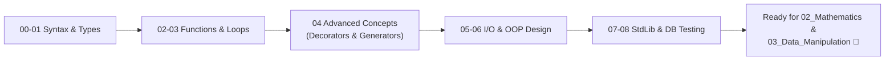

# 01 Python Basics: Core Language Fundamentals

> **Module Focus:** Syntax · Data Structures · Functions · Control Flow · OOP · Standard Library · Testing · Database I/O

---

## 📖 Overview

This module forms the bedrock of the entire Data Science curriculum. It covers modern, idiomatic Python 3—moving from foundational syntax to object-oriented programming, exception management, testing, and standard library utilities with inline examples, docstrings, and verified outputs.

---

## 📂 File Index & Syllabus

| File | Core Concepts Covered | Key Python Features |
|---|---|---|
| [`00_python_basics.py`](./00_python_basics.py) | Syntax basics, dynamic typing, arithmetic, string formatting (`f-strings`), type casting. | `print()`, `type()`, `id()`, operators |
| [`01_data_types_and_methods.py`](./01_data_types_and_methods.py) | Deep dive into built-in collections: Lists, Tuples, Sets, and Dictionaries. | `.append()`, `.extend()`, `.get()`, list/dict comprehensions |
| [`02_functions.py`](./02_functions.py) | Function signatures, default arguments, `*args`, `**kwargs`, lambda functions, closures, scope (`global`, `nonlocal`). | `def`, `lambda`, `return`, `LEGB` scope |
| [`03_loops_and_iteration.py`](./03_loops_and_iteration.py) | `for` and `while` loops, `enumerate()`, `zip()`, loop control (`break`, `continue`, `else`), nested iterations. | Iteration protocol, dictionary unpacking |
| [`04_essential_python_concepts.py`](./04_essential_python_concepts.py) | Iterators & Iterables, Generators (`yield`), Decorators (`@wrapper`), Docstrings, Type Hinting (`typing`), Common Errors. | `iter()`, `next()`, `yield`, `@functools.wraps` |
| [`05_exceptions_and_file_handling.py`](./05_exceptions_and_file_handling.py) | Context managers (`with`), file reading/writing (TXT, JSON, CSV), custom exception classes, `try/except/else/finally`. | `open()`, `json`, `csv`, `raise`, `Exception` |
| [`06_OOP.py`](./06_OOP.py) | Object-Oriented Programming: Classes, Instances, `__init__`, Encapsulation (private `_`/`__`), Inheritance (`super()`), Polymorphism, Class & Static methods (`@classmethod`, `@staticmethod`), Dunder methods (`__str__`, `__repr__`, `__len__`). | OOP design patterns, property decorators (`@property`) |
| [`07_standard_library.py`](./07_standard_library.py) | Essential standard library modules: `math`, `random`, `datetime`, `collections` (`Counter`, `defaultdict`), `itertools`, `os`, `pathlib`, `re` (Regex). | High-speed built-ins without external pip dependencies |
| [`08_testing_and_database_connectivity.py`](./08_testing_and_database_connectivity.py) | Unit testing with `unittest` and `pytest`, SQLite database interaction (`sqlite3`), parameter binding, CRUD operations, transactions (`commit`, `rollback`). | `sqlite3`, `unittest.TestCase`, assertions |
| [`utils.py`](./utils.py) | Reusable helper functions shared across scripts. | Helper formatting and validation |
| [`Files/`](./Files) | Sample data files used for testing file operations: `example_csv.csv`, `example_json.json`, `example_txt.txt`. | Test assets |

---

## 🎯 Learning Roadmap



---

## 💻 How to Practice

1. **Direct Terminal Execution:**
   ```bash
   python 00_python_basics.py
   python 06_OOP.py
   ```
2. **Interactive Cell Mode (VS Code):**
   Open any `.py` script in VS Code and execute code blocks interactively using `# %%` cells or Shift+Enter.
3. **Run Unit Tests:**
   ```bash
   python -m unittest 08_testing_and_database_connectivity.py
   ```
