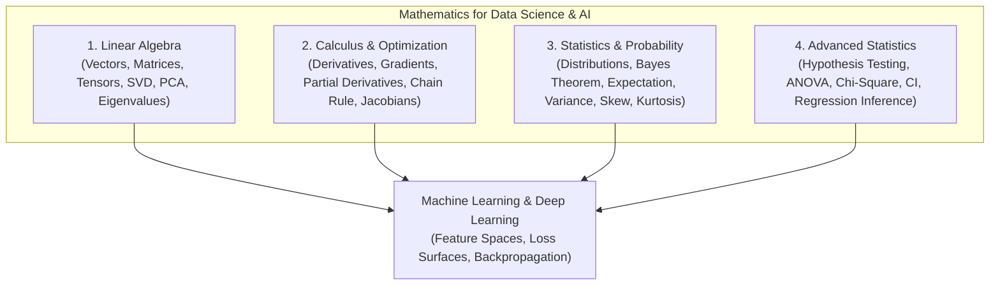

# 02 Mathematics: Theoretical Foundations for Data Science & ML

> **Module Focus:** Linear Algebra · Calculus · Probability & Descriptive Statistics · Advanced Statistical Inference & Hypothesis Testing

---

## 📖 Overview

Mathematics is the underlying engine of machine learning algorithms, deep neural networks, and statistical inference. This module organizes the mathematical foundations into four dedicated branches, bridging theoretical equations with practical Python implementations (`NumPy`, `SciPy`, `SymPy`).

---

## 📂 Subfolder Structure & Syllabi

### 1. [Linear Algebra](./Linear%20Algebra)
*The language of multi-dimensional data and model parameters.*
* **Core Topics:** Scalars, Vectors, Vector Spaces, Dot Products, Vector Norms ($L_1$, $L_2$, $L_\infty$), Matrix Multiplication, Determinants, Matrix Inverses, Rank, Eigenvalues & Eigenvectors, Spectral Decomposition, Singular Value Decomposition (SVD), Principal Component Analysis (PCA).
* **Reference:** [`Linear Algebra/README.md`](./Linear%20Algebra/README.md) — Comprehensive guide with matrix properties, rank theorems, and Python examples.

---

### 2. [Calculus](./Calculus)
*The engine of optimization, loss reduction, and neural network backpropagation.*
* **Core Topics:** Functions, Limits, Continuity, Derivatives, Common Derivative Rules (Product, Quotient, Chain Rule), Partial Derivatives, Gradients ($\nabla f$), Directional Derivatives, Hessian Matrices (Curvature), Taylor Series, Gradient Descent algorithms (SGD, Momentum, Adam).
* **Reference:** [`Calculus/README.md`](./Calculus/README.md) — Mathematical derivations and step-by-step calculus explanations.

---

### 3. [Statistics & Probability](./Statistics%20&%20Probability)
*Quantifying uncertainty, randomness, and data distributions.*
* **Core Topics:** Random Variables, Probability Mass Functions (PMF), Probability Density Functions (PDF), Cumulative Distribution Functions (CDF), Expected Value, Variance, Standard Deviation, Covariance & Pearson Correlation, Bayes' Theorem.
* **Distributions Explored:** Uniform, Normal (Gaussian), Binomial, Poisson, Exponential, Student's t, Bernoulli.
* **Skewness & Kurtosis:** Measuring asymmetry and heavy tails.
* **Files:**
  * [`Statistics & Probability/Statistics & probability.md`](./Statistics%20&%20Probability/Statistics%20&%20probability.md): Core guide with distribution formulas and visual diagrams.
  * [`Statistics & Probability/scipy_stat.py`](./Statistics%20&%20Probability/scipy_stat.py): Python implementations using `scipy.stats`.
  * [`Statistics & Probability/Photos/`](./Statistics%20&%20Probability/Photos): Visual plots (`normal.png`, `binomial.png`, `Poisson.png`, `Skew.png`, `Kurtosis.png`).

---

### 4. [Advanced Statistics](./Advanced%20Statistics)
*Inferential statistics, experimental design, and hypothesis validation.*
* **Core Topics:** Central Limit Theorem (CLT), Sampling Distributions, Standard Error, Confidence Intervals, Hypothesis Testing Framework (Null $H_0$ vs. Alternative $H_1$, Type I & Type II Errors, $\alpha$ significance level, $p$-values).
* **Statistical Tests:** One-sample & Two-sample t-tests, Paired t-test, Z-test, One-Way & Two-Way ANOVA ($F$-statistic), Chi-Square ($\chi^2$) Goodness-of-Fit and Independence tests, Mann-Whitney U & Wilcoxon non-parametric tests.
* **Files:**
  * [`Advanced Statistics/README.md`](./Advanced%20Statistics/README.md): Exhaustive guide to statistical testing and decision rules.
  * [`Advanced Statistics/Examples.py`](./Advanced%20Statistics/Examples.py): Runnable Python code executing every test with `scipy.stats` and `statsmodels`.

---

## 🎯 Suggested Learning Path

1. **Foundations (Weeks 1–2):** Master [`Statistics & Probability`](./Statistics%20&%20Probability) and [`Linear Algebra`](./Linear%20Algebra) to understand data shapes and summary metrics.
2. **Optimization (Week 3):** Study [`Calculus`](./Calculus) to understand how loss functions are minimized via gradients.
3. **Inference (Week 4):** Deep dive into [`Advanced Statistics`](./Advanced%20Statistics) for A/B testing, experiment analysis, and statistical significance.
