# 03 Data Manipulation: NumPy & Pandas Master Reference

> **Module Focus:** N-Dimensional Array Computing (`NumPy`) · Structured DataFrames & Series (`Pandas`) · Data Cleansing · Grouping & Merging · Time Series

---

## 📖 Overview

Data manipulation is where 80% of data science time is spent. This module contains 17 focused Python reference scripts organized into **NumPy** (vectorized numerical computing) and **Pandas** (tabular data transformation, cleaning, and aggregation), complete with inline comments and execution examples.

```mermaid
flowchart LR
    subgraph NumPy_Engine["NumPy (Array Engine)"]
        direction TB
        N1["01 Array Creation & Types"]
        N2["02 Reshaping & Slicing"]
        N3["03 Search, Sort & Filter"]
        N4["04 Random Sampling & Distributions"]
        N5["05 Universal Functions (ufuncs)"]
        N6["06 Linear Algebra & Broadcasting"]
    end

    subgraph Pandas_Engine["Pandas (Tabular Engine)"]
        direction TB
        P1["01-02 Fundamentals & Selection (.loc / .iloc)"]
        P3["03-04 Data Cleansing & Column Ops"]
        P5["05 GroupBy & Aggregations"]
        P6["06 Reshaping (Pivot, Melt, Stack)"]
        P7["07 Combining Data (Concat, Merge, Join)"]
        P8["08 String & Categorical Transformations"]
        P9["09 DateTime & Time Series Analysis"]
        P10["10 Statistical Utilities & Performance"]
    end

    NumPy_Engine --> Pandas_Engine
    Pandas_Engine --> Analytics["Data Visualization, SQL &\nMachine Learning 🚀"]
```



---

## 📂 Subfolders & Script Index

### 🔢 [numpy/](./numpy) — N-Dimensional Vectorized Computing

| File | Core Concepts & Functions |
|---|---|
| [`numpy/01_array_basics.py`](./numpy/01_array_basics.py) | Array creation (`np.array`, `np.zeros`, `np.ones`, `np.arange`, `np.linspace`), data types (`dtype`), memory layout, array attributes (`ndim`, `shape`, `size`, `itemsize`). |
| [`numpy/02_array_shaping.py`](./numpy/02_array_shaping.py) | Array reshaping (`.reshape()`, `-1` wildcard), flattening (`.flatten()`, `.ravel()`), transposing (`.T`, `np.transpose()`), stacking (`np.vstack`, `np.hstack`, `np.concatenate`), splitting (`np.split`). |
| [`numpy/03_search_and_order.py`](./numpy/03_search_and_order.py) | Indexing & boolean masking (`arr[arr > 5]`), searching (`np.where`, `np.nonzero`, `np.searchsorted`), sorting (`np.sort`, `np.argsort` for indices). |
| [`numpy/04_random_number.py`](./numpy/04_random_number.py) | Random sampling via `np.random` (`rand`, `randn`, `randint`, `choice`), setting seeds (`np.random.seed`), generating normal, uniform, and binomial distributions. |
| [`numpy/05_math_ufuncs.py`](./numpy/05_math_ufuncs.py) | Element-wise Universal Functions (ufuncs): arithmetic, trigonometry, exponents (`np.exp`), logarithms (`np.log`, `np.log1p`), rounding, cumulative sums (`np.cumsum`), products. |
| [`numpy/06_other_topics.py`](./numpy/06_other_topics.py) | Array broadcasting rules, memory views vs. deep copies (`.copy()`), linear algebra basics (`np.dot`, `np.matmul`, `@`, `np.linalg.inv`, `np.linalg.det`), saving/loading `.npy` and `.npz` files. |

---

### 🐼 [pandas/](./pandas) — Tabular Data Wrangling & Analysis

| File | Core Concepts & Methods |
|---|---|
| [`pandas/01_fundamentals.py`](./pandas/01_fundamentals.py) | Series & DataFrame anatomy, creation from dicts/lists, I/O operations (`read_csv`, `to_csv`, `read_parquet`, `to_parquet`), inspection (`.head()`, `.tail()`, `.info()`, `.describe()`, `.dtypes`). |
| [`pandas/02_selection_and_filtering.py`](./pandas/02_selection_and_filtering.py) | Label-based indexing (`.loc`), position-based indexing (`.iloc`), conditional boolean filtering with logical operators (`&`, `\|`, `~`), `.isin()`, `.between()`, `.query()` method. |
| [`pandas/03_data_cleaning.py`](./pandas/03_data_cleaning.py) | Handling missing data (`.isna()`, `.notna()`, `.dropna()`, `.fillna()`, forward/backward fill), handling duplicates (`.duplicated()`, `.drop_duplicates()`), renaming columns, type casting (`.astype()`). |
| [`pandas/04_series_and_column_operations.py`](./pandas/04_series_and_column_operations.py) | Column math, vector operations, mapping (`.map()`), applying functions across elements (`.apply()`), vectorized conditional assignment (`np.where`, `.replace()`). |
| [`pandas/05_grouping_and_aggregation.py`](./pandas/05_grouping_and_aggregation.py) | The Split-Apply-Combine pattern: `.groupby()`, multiple aggregations (`.agg(['mean', 'std', 'count'])`), named aggregations, `.transform()` for group-level calculations, `.filter()`. |
| [`pandas/06_indexing_and_reshaping.py`](./pandas/06_indexing_and_reshaping.py) | MultiIndex (Hierarchical indexing), pivoting (`.pivot()`, `.pivot_table()`), unpivoting (`.melt()`), stacking & unstacking (`.stack()`, `.unstack()`), `.crosstab()`. |
| [`pandas/07_combining_data.py`](./pandas/07_combining_data.py) | Appending along axes (`pd.concat()`), SQL-style relational joining (`pd.merge()` with inner, left, right, outer joins, on keys, left_on/right_on), `.join()`. |
| [`pandas/08_data_transformation.py`](./pandas/08_data_transformation.py) | String manipulations via `.str` accessor (`.lower()`, `.contains()`, `.extract()`, `.split()`), categorical data encoding (`pd.Categorical`, `pd.get_dummies()`), binning numerical values (`pd.cut()`, `pd.qcut()`). |
| [`pandas/09_dates_and_time_series.py`](./pandas/09_dates_and_time_series.py) | DateTime parsing (`pd.to_datetime()`), setting DatetimeIndex, `.dt` accessor (year, month, day, dayofweek), date ranges (`pd.date_range()`), frequency resampling (`.resample('ME')`, `.resample('D')`), rolling window statistics (`.rolling(window=7).mean()`), shifting (`.shift()`). |
| [`pandas/10_analysis_and_utilities.py`](./pandas/10_analysis_and_utilities.py) | Correlation matrices (`.corr()`), ranking (`.rank()`), memory optimization (`float32`, `category`), `.nlargest()`, `.nsmallest()`, styling DataFrames. |
| [`pandas/utils.py`](./pandas/utils.py) | Reusable helper utility functions. |

---

## 💻 How to Use & Run

```bash
# 1. Run any NumPy module
python numpy/01_array_basics.py

# 2. Run any Pandas module
python pandas/05_grouping_and_aggregation.py

# 3. Interactive exploration in VS Code
# Open any script and press Shift+Enter to run interactively in the Python Interactive Window!
```
