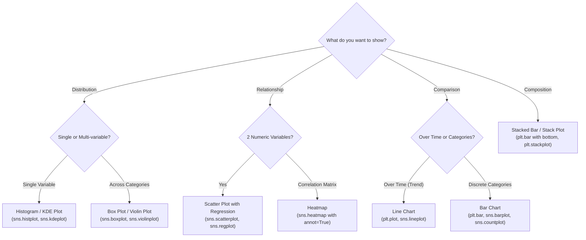

# 04 Data Visualization: Matplotlib & Seaborn Visual Analytics

> **Module Focus:** Exploratory Data Analysis (EDA) · Statistical Plotting · Visual Storytelling · Matplotlib · Seaborn

---

## 📖 Overview

Data visualization transforms raw numbers into intuitive visual patterns, outliers, and distributions. This module provides hands-on tutorials and reusable boilerplate code using Python's two core plotting libraries: **Matplotlib** (fine-grained object-oriented plotting control) and **Seaborn** (high-level statistical visualization with aesthetic defaults).

---

## 📂 File Index

| File | Type | Focus & Content |
|---|---|---|
| [`data_setup.py`](./data_setup.py) | Python Script | Generates reproducible synthetic datasets (time series, categorical groups, distributions) used across tutorials. |
| [`matplotlib_tutorial.ipynb`](./matplotlib_tutorial.ipynb) | Jupyter Notebook | Complete Matplotlib guide: Figure & Axes anatomy (`fig, ax`), line plots, bar charts, horizontal bars, histograms, scatter plots, subplots (`plt.subplots`), twin axes, colorbars, and annotations. |
| [`seaborn_tutorial.ipynb`](./seaborn_tutorial.ipynb) | Jupyter Notebook | Statistical plotting with Seaborn: Distribution plots (`histplot`, `kdeplot`), Categorical plots (`boxplot`, `violinplot`, `stripplot`, `countplot`), Relational plots (`scatterplot`, `lineplot`), Matrix plots (`heatmap`), and Regression plots (`regplot`, `lmplot`, `pairplot`). |

---

## 📊 Chart Selection Cheat Sheet



---

## 🎨 Best Practices for Production Visualizations

1. **The Object-Oriented Interface:** Always prefer `fig, ax = plt.subplots()` over stateful `plt.plot()` calls for full customization of titles, labels, limits, and gridlines.
2. **Accessible Color Palettes:** Use Seaborn color palettes with high contrast (`palette='viridis'`, `palette='mako'`, or colorblind-safe `palette='colorblind'`).
3. **Data-to-Ink Ratio:** Remove visual clutter—soften gridlines (`alpha=0.3`), remove chart junk, and format axis labels clearly (e.g. `\$12.5M` instead of `12500000`).

---

## 💻 How to Run

```bash
# 1. Install dependencies
pip install matplotlib seaborn pandas numpy jupyter

# 2. Launch Jupyter Notebook
jupyter notebook

# 3. Open matplotlib_tutorial.ipynb or seaborn_tutorial.ipynb
```
