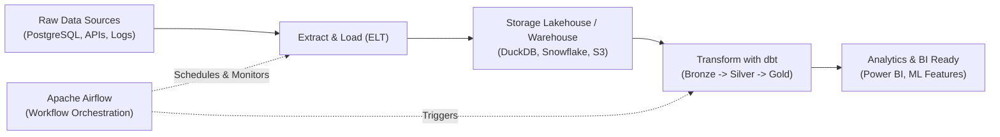

# 06 Data Engineering: Modern ELT, Orchestration & Pipelines

> **Module Focus:** Data Storage Architectures · ETL vs. ELT · Data Modeling (Star & Snowflake) · Apache Airflow · dbt (Data Build Tool) · Batch vs. Streaming

---

## 📖 Overview

Data Engineering is the practice of designing, building, and maintaining reliable systems that collect, clean, transform, and deliver data at scale. This module bridges high-level architecture principles with **hands-on production tooling** featuring **Apache Airflow** and **dbt**.

---

## 🛠️ Hands-on Tooling Implementations

### 1. [Airflow/ — Workflow Orchestration](./Airflow)
* **What it does:** Orchestrates and schedules data extraction, validation, and loading pipelines as Directed Acyclic Graphs (DAGs).
* **Stack:** Full Docker Compose setup running Airflow Webserver (port `8080`), Scheduler, Celery Workers, Redis broker, and PostgreSQL metadata backend.
* **Guide:** See [`Airflow/README.md`](./Airflow/README.md) for startup commands, DAG anatomy, and environment variables.

---

### 2. [dbt/ — Modern Analytics Engineering](./dbt)
* **What it does:** The industry standard for **in-warehouse transformations (ELT)**. Writes modular SQL models with built-in version control, documentation, and automated testing.
* **Stack:** `dbt-core` with `DuckDB` local fast OLAP engine.
* **Includes:**
  * Seed data: `df_Orders.csv`, `df_OrderItems.csv`, `df_Products.csv`, `df_Customers.csv`, `df_Payments.csv`.
  * Dimensional Modeling: Staging layer (`stg_orders`, `stg_customers`), Dimension tables (`dim_customers`, `dim_products`), and Fact tables (`fct_orders`).
* **Guide:** See [`dbt/README.md`](./dbt/README.md) for dbt CLI commands (`dbt run`, `dbt test`, `dbt docs generate`).

---

## 📚 Core Theoretical Concepts

### 1. ETL vs. ELT ⚖️
- **ETL (Extract, Transform, Load):** Data is transformed in a staging area *before* loading into the target warehouse. Used in legacy systems, on-premises databases, and when target compute is limited.
- **ELT (Extract, Load, Transform):** Raw data is loaded directly into modern cloud data warehouses (Snowflake, BigQuery, Databricks, DuckDB), leveraging massive cloud compute to transform data in-place using SQL/dbt.

### 2. Storage Architectures: Lake vs. Warehouse vs. Lakehouse 🏗️
- **Data Warehouse (OLAP):** Structured, processed, highly governed data. Schema-on-write. Optimized for fast BI aggregations.
- **Data Lake:** Raw, unstructured, semi-structured, and structured data stored cheaply (e.g. AWS S3, Azure ADLS). Schema-on-read.
- **Data Lakehouse:** Modern hybrid combining low-cost flexible object storage with ACID transactions, versioning, and fast SQL engines (e.g. Databricks Delta Lake, Apache Iceberg).

### 3. Dimensional Modeling: Star vs. Snowflake Schema 🧱
- **Fact Tables:** Contain numerical measurements and transaction events (e.g., `order_amount`, `quantity_sold`, `discount`).
- **Dimension Tables:** Contain descriptive context and attributes (e.g., `customer_name`, `product_category`, `store_location`).
- **Star Schema:** Denormalized. Fact table surrounded by flat dimension tables. Fewest joins, fastest query performance.
- **Snowflake Schema:** Normalized. Dimensions broken into sub-tables (e.g., `products` $\to$ `categories` $\to$ `departments`). Saves storage, requires more joins.

### 4. Medallion Architecture (Bronze $\to$ Silver $\to$ Gold) 🥇
- **Bronze (Raw):** Exact raw copy of source records (appended history).
- **Silver (Cleansed):** Deduplicated, schema-validated, filtered, and enriched.
- **Gold (Aggregated):** Business-level aggregations, dimensional marts ready for BI and ML models.

### 5. Data Quality, Contracts & Lineage 🛡️
- **Data Contracts:** Formal agreements specifying schema, data types, freshness, and nullability between data producers and downstream consumers.
- **Data Lineage:** Complete visual audit trail tracking data provenance from raw source tables to final executive dashboard metrics.
