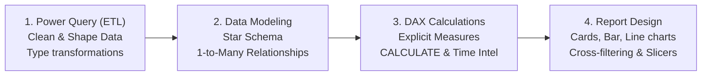

# 07 Power BI: Business Intelligence, DAX & Dashboards

> **Module Focus:** Data Modeling · DAX (Data Analysis Expressions) · Interactive Dashboards · Visual Analytics · KPIs

---

## 📖 Overview

Power BI is Microsoft's premier Business Intelligence tool for connecting disparate data sources, building star-schema data models, writing expressive calculations via DAX, and publishing executive dashboards that drive commercial decisions.

---

## 📂 Contents & Structure

| Folder / File | Type | Focus & Overview |
|---|---|---|
| [`DAX/`](./DAX) | Directory | Comprehensive guide to **Data Analysis Expressions (DAX)** — syntax rules, row context vs. filter context, calculated columns vs. explicit measures, and essential functions (`CALCULATE`, `FILTER`, `RELATED`, `SUMX`, `DIVIDE`, Time Intelligence). See [`DAX/README.md`](./DAX/README.md). |
| [`Visuals/`](./Visuals) | Directory | Interactive reporting project. |
| [`Visuals/Visuals.pbix`](./Visuals/Visuals.pbix) | Power BI Report | Full Power BI Desktop report containing the underlying dimensional model, relationship links, custom DAX measures, and interactive KPI visualizations. |
| `Visuals/job_postings_flat.csv` | Dataset | Sample job postings analytical dataset powering the report. |

---

## 🧠 Power BI Architecture: From Data to Decision

### Key DAX Rules to Remember
1. **Always Use Measures, Avoid Calculated Columns:** Calculated columns consume RAM memory in the VertiPaq tabular engine. Measures are calculated dynamically on the fly during query evaluation.
2. **`CALCULATE` is King:** The most powerful DAX function. It alters or overrides the existing filter context (e.g. `CALCULATE([Total Sales], ALL(Dim_Date))`).
3. **Always Use `DIVIDE` over `/`:** `DIVIDE(Numerator, Denominator, 0)` safely handles division by zero without crashing visuals.

---

## 💻 How to Use

1. Download and install [Power BI Desktop](https://www.microsoft.com/en-us/power-platform/products/power-bi/downloads) (Windows).
2. Open [`Visuals/Visuals.pbix`](./Visuals/Visuals.pbix) to explore the data model, cross-highlighting, and DAX measures.
3. Review [`DAX/README.md`](./DAX/README.md) to practice writing business metrics.
