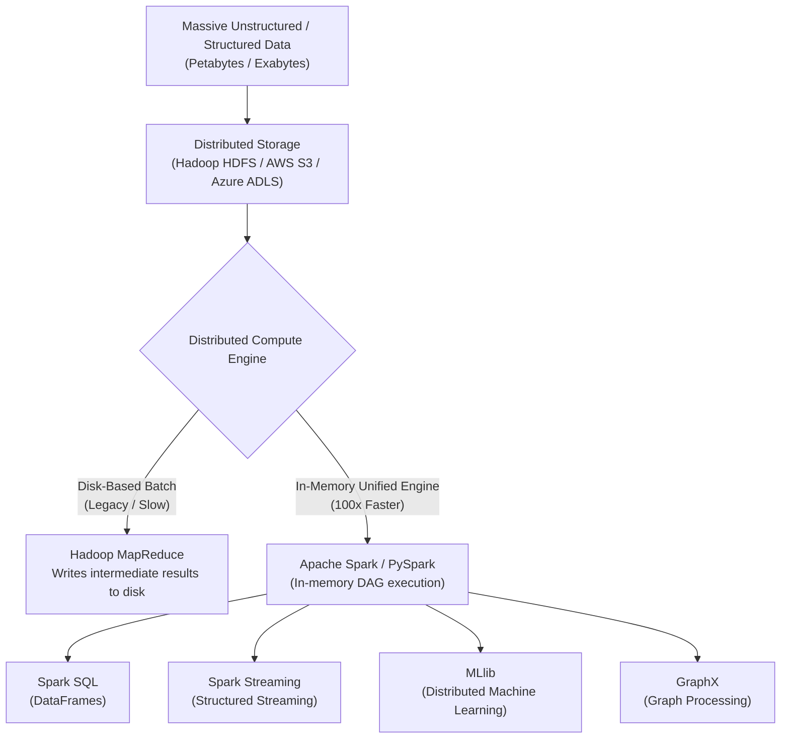

# 08 Big Data: Distributed Computing with Hadoop & Apache Spark

> **Module Focus:** Distributed Systems · The 5 Vs · HDFS & YARN · Apache Spark & PySpark · In-Memory Computing · Batch vs. Real-Time Streaming

---

## 📖 Overview

When datasets exceed the memory (RAM) and storage capacity of a single machine, traditional data science tools (Pandas, Scikit-Learn) throw `OutOfMemoryError` exceptions. **Big Data distributed computing** solves this by partitioning datasets across a cluster of commodity servers, processing workloads in parallel with fault tolerance.



---

## 📦 The 5 Vs of Big Data

| V | Dimension | Description | Enterprise Example |
|---|---|---|---|
| **Volume** | Scale | The sheer quantity of data (terabytes to petabytes). | Global credit card transactions, clickstream events. |
| **Velocity** | Speed | The rate at which incoming data is generated and must be processed. | Real-time stock ticker feeds, IoT telematics. |
| **Variety** | Diversity | Heterogeneous formats: structured, semi-structured, unstructured. | SQL tables, JSON logs, sensor time-series, video feeds. |
| **Veracity** | Quality | Data reliability, noise, bias, missing records, inconsistencies. | GPS inaccuracies, web scraping duplicates. |
| **Value** | Business Impact | The actionable commercial insight extracted from raw data. | Algorithmic fraud prevention, customer retention. |

---

## 🐘 Hadoop: The Distributed Foundation

Apache Hadoop was the first open-source framework to enable fault-tolerant distributed storage and batch computation:

### 1. HDFS (Hadoop Distributed File System)
- Breaks large files into fixed-size blocks (default: **128 MB**).
- Replicates each block across multiple nodes (default: **$3\times$ replication factor**) for hardware fault tolerance.
- **NameNode (Master):** Stores file tree metadata and block locations in RAM.
- **DataNodes (Workers):** Store the physical data blocks on disk.

### 2. YARN (Yet Another Resource Negotiator)
- Cluster operating system: manages CPU and RAM resource allocation across worker nodes.
- **ResourceManager (Global):** Arbitrates cluster compute capacity.
- **NodeManager (Per-node):** Monitors container CPU/memory usage on individual machines.

### 3. MapReduce (Disk-Bound Batch Processing)
- **Map:** Filters and transforms data in parallel across nodes where data lives (*Data Locality Principle*).
- **Shuffle & Sort:** Re-distributes data across network by key.
- **Reduce:** Aggregates and writes final results back to HDFS disk.
- *Limitation:* Iterative algorithms (like gradient descent or graph processing) are slow because intermediate states are constantly written to and read from physical disks.

---

## ⚡ Apache Spark: The In-Memory Revolution

Apache Spark overcomes MapReduce limitations by keeping intermediate data in **RAM**, achieving up to **$100\times$ faster execution**.

### 1. Core Architecture
- **Driver Program:** Coordinates execution, creates the `SparkContext` / `SparkSession`, and converts user code into a Directed Acyclic Graph (DAG) of stages.
- **Cluster Manager:** Allocates cluster resources (YARN, Kubernetes, or Spark Standalone).
- **Executors:** Worker JVM processes that run tasks and store cached data partitions in RAM.

### 2. Abstractions: RDDs vs. DataFrames
- **RDD (Resilient Distributed Dataset):** Low-level immutable collection partitioned across cluster nodes.
- **DataFrame:** Distributed collection organized into named columns (like Pandas/SQL), optimized by the **Catalyst Optimizer** and **Tungsten binary execution engine**.

### 3. Transformations vs. Actions (Lazy Evaluation)
Spark does not compute anything until an **Action** is called:
- **Transformations (Lazy):** Build the execution plan without running (`.select()`, `.filter()`, `.groupBy()`, `.map()`).
- **Actions (Eager):** Trigger the DAG execution and return results to Driver or write to storage (`.count()`, `.collect()`, `.show()`, `.write.parquet()`).

```python
# PySpark Example Workflow
from pyspark.sql import SparkSession

spark = SparkSession.builder.appName("RideAnalytics").getOrCreate()

# 1. Lazy transformation (reads metadata, doesn't load data yet)
df = spark.read.parquet("s3://mlops-data/rides.parquet")
filtered_df = df.filter(df["trip_distance"] > 5.0)
aggregated_df = filtered_df.groupBy("PULocationID").avg("trip_duration_minutes")

# 2. Action triggers distributed cluster computation
aggregated_df.show(10)
```

---

## ⚖️ Hadoop MapReduce vs. Apache Spark

| Feature | Hadoop MapReduce | Apache Spark |
|---|---|---|
| **Processing Speed** | Slow (Disk I/O between stages) | **Fast ($10–100\times$ faster due to in-memory DAGs)** |
| **Primary Memory** | Disk-centric | **RAM-centric (Spills to disk only if needed)** |
| **API Ease of Use** | Verbose Java boilerplate | **Python (PySpark), SQL, Scala, R** |
| **Streaming Support** | Batch only | **Native Structured Streaming (sub-second latency)** |
| **Machine Learning** | Mahout (Slow disk iterations) | **Spark MLlib (Fast in-memory iterative training)** |
| **Current Role** | Legacy / Deep cold archival | **Modern Big Data Standard** |
