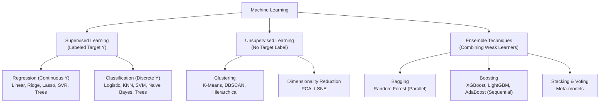

# Machine Learning: Algorithms, Ensembles & Scikit-Learn

> **Module Focus:** Supervised Learning · Unsupervised Learning · Ensemble Architectures · Scikit-Learn API · Model Evaluation

---

## 📖 Overview

This subfolder provides an in-depth reference for core machine learning paradigms. It combines theoretical algorithmic derivations with visual architectural diagrams and an end-to-end applied Jupyter notebook using `scikit-learn`.

---

## 📂 Contents & Structure

| File / Folder | Focus & Description |
|---|---|
| [`models/01_supervised_learning.md`](./models/01_supervised_learning.md) | **Supervised Learning Guide:** Linear Regression, Ridge & Lasso ($L_1$/$L_2$), Logistic Regression, K-Nearest Neighbors (KNN), Naive Bayes, Support Vector Machines (SVM & Kernels), and Decision Trees (Gini vs Entropy). |
| [`models/02_unsupervised_learning.md`](./models/02_unsupervised_learning.md) | **Unsupervised Learning Guide:** Clustering algorithms (K-Means, Hierarchical Clustering, DBSCAN) and Dimensionality Reduction (Principal Component Analysis / PCA, t-SNE). |
| [`models/03_enseble_learning.md`](./models/03_enseble_learning.md) | **Ensemble Learning Guide:** Bagging (Random Forest, Out-of-Bag error), Boosting (AdaBoost, Gradient Boosting, XGBoost), Voting Classifiers, and Multi-tier Stacking. |
| [`models/04_applied_machine_learning.ipynb`](./models/04_applied_machine_learning.ipynb) | **Applied End-to-End Notebook:** Complete practical ML workflow: EDA, preprocessing, feature scaling, training multiple models, `GridSearchCV` hyperparameter tuning, cross-validation, and metrics (Confusion Matrix, ROC-AUC, F1, RMSE). |
| [`models/images/`](./models/images) | High-resolution visual diagrams supporting algorithmic concepts: Decision Trees, KNN, Linear Regression, Logistic Regression, Naive Bayes, Neural Networks, and SVM boundaries. |
| [`scikit_learn properties.md`](./scikit_learn%20properties.md) | **Scikit-Learn Mastery Cheat Sheet:** Complete reference on estimators (`.fit()`, `.predict()`), transformers (`.fit_transform()`), Pipelines, ColumnTransformers, scoring metrics, and attribute naming conventions. |

---

## 🧠 Machine Learning Taxonomy



---

## 💻 How to Run

```bash
# 1. Install dependencies
pip install scikit-learn pandas numpy matplotlib seaborn jupyter

# 2. Launch the applied notebook
jupyter notebook models/04_applied_machine_learning.ipynb
```
