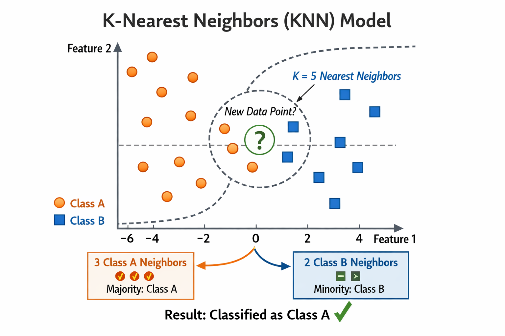
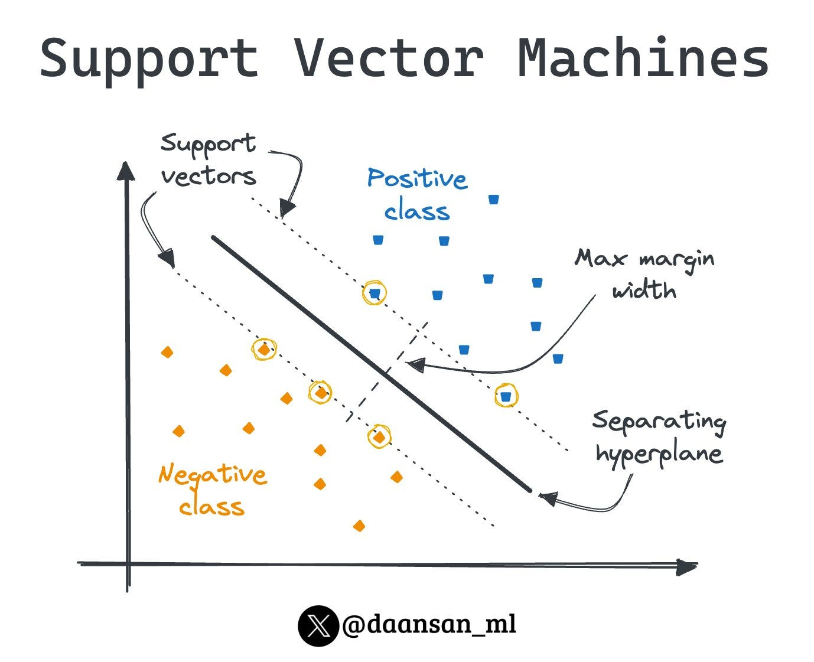

# 🎯 Supervised Learning

A structured guide to supervised machine learning algorithms: models that learn from **labeled data** to predict either a category (**classification**) or a number (**regression**).

## 📚 Contents

1. [Linear Regression 📈](#lr)
   - [What is Linear Regression? 🤔](#lr-what-is-linear-regression)
   - [How Does Linear Regression Work? 🔍](#lr-how-does-linear-regression-work)
   - [The Main Formula 📐](#lr-the-main-formula)
   - [The Cost Function: Mean Squared Error (MSE) 📉](#lr-the-cost-function-mean-squared-error-mse)
   - [The Learning Process: Finding the Best Parameters 🧠](#lr-the-learning-process-finding-the-best-parameters)
   - [Regularization: Preventing Overfitting 🛡️](#lr-regularization-preventing-overfitting)
   - [Polynomial Regression 📐➡️🔄](#lr-polynomial-regression)
   - [Quick Comparison](#lr-quick-comparison)

2. [Logistic Regression 📊](#logreg)
   - [What is Logistic Regression? 🤖](#logreg-what-is-logistic-regression)
   - [The Sigmoid Function (Core Formula) 📉](#logreg-the-sigmoid-function-core-formula)
   - [Log Loss Function (Binary Cross-Entropy) 📉](#logreg-log-loss-function-binary-cross-entropy)
   - [Multinomial Logistic Regression (Multi-Class) 🔢](#logreg-multinomial-logistic-regression-multi-class)
   - [Softmax Function 🧠](#logreg-softmax-function)
   - [Training with Gradient Descent](#logreg-training-with-gradient-descent)

3. [K-Nearest Neighbors (KNN) 👥](#knn)
   - [What is KNN? 🤔](#knn-what-is-knn)
   - [How Does KNN Work? 🔄](#knn-how-does-knn-work)
   - [Choosing the Right K ⚖️](#knn-choosing-the-right-k)
   - [Advantages ✅](#knn-advantages)
   - [Disadvantages ❌](#knn-disadvantages)

4. [Naive Bayes 📧](#nb)
   - [What is Naive Bayes? 🤓](#nb-what-is-naive-bayes)
   - [How Does Naive Bayes Work? 🔍](#nb-how-does-naive-bayes-work)
   - [Types of Naive Bayes Classifiers 📊](#nb-types-of-naive-bayes-classifiers)
   - [Training and Prediction Process ⚙️](#nb-training-and-prediction-process)
   - [Advantages ✅](#nb-advantages)
   - [Disadvantages ❌](#nb-disadvantages)

5. [Support Vector Machine (SVM) ⚔️](#svm)
   - [What is Support Vector Machine? 🤖](#svm-what-is-support-vector-machine)
   - [How Does SVM Work? 🔍](#svm-how-does-svm-work)
   - [Advantages ✅](#svm-advantages)
   - [Disadvantages ❌](#svm-disadvantages)
   - [Support Vector Regression (SVR) 📈](#svm-support-vector-regression-svr)

6. [Decision Trees 🌳](#dt)
   - [What is a Decision Tree? 🤔](#dt-what-is-a-decision-tree)
   - [How Does a Decision Tree Work? 🔀](#dt-how-does-a-decision-tree-work)
   - [Decision Trees for Regression 📈 (Using MSE)](#dt-decision-trees-for-regression-using-mse)
   - [Decision Trees for Classification 📊 (Entropy & Gini)](#dt-decision-trees-for-classification-entropy-gini)
   - [Advantages ✅](#dt-advantages)
   - [Disadvantages ❌](#dt-disadvantages)

7. [Neural Networks 🧠](#nn)
   - [What is a Neural Network? 🌐](#nn-what-is-a-neural-network)
   - [How Does a Neural Network Work? 🔄](#nn-how-does-a-neural-network-work)
   - [Training the Network: Backpropagation 📉](#nn-training-the-network-backpropagation)
   - [Key Concepts in Deep Learning 🧩](#nn-key-concepts-in-deep-learning)
   - [Advantages ✅](#nn-advantages)
   - [Disadvantages ❌](#nn-disadvantages)
   - [Summary 🎯](#nn-summary)

---

## 🧭 Algorithms at a Glance

| # | Algorithm | Task | Core idea | Typical use |
|---|-----------|------|-----------|-------------|
| 1 | [Linear Regression](#lr) | Regression | Fit the best straight line (or hyperplane) by minimizing MSE | House prices, sales forecasting |
| 2 | [Logistic Regression](#logreg) | Classification | Squash a linear score into a probability with sigmoid / softmax | Spam detection, churn prediction |
| 3 | [K-Nearest Neighbors](#knn) | Classification & regression | Vote or average over the K closest training points | Recommendations, handwriting recognition |
| 4 | [Naive Bayes](#nb) | Classification | Bayes' theorem with a feature-independence assumption | Text, spam, sentiment analysis |
| 5 | [Support Vector Machine](#svm) | Classification & regression | Maximum-margin hyperplane, kernel trick for non-linear data | Images, text categorization, bioinformatics |
| 6 | [Decision Trees](#dt) | Classification & regression | Recursive if-else splits chosen by MSE, entropy, or Gini | Churn, loan approval |
| 7 | [Neural Networks](#nn) | Classification & regression | Layers of neurons trained with backpropagation | Vision, NLP, speech |

---

## 1. Linear Regression 📈

### What is Linear Regression? 🤔

**Linear Regression** is one of the simplest and most fundamental supervised machine learning algorithms. It is used to predict a **continuous numerical value** (the target or dependent variable) based on one or more **input features** (independent variables).

#### Real-world Examples:
- Predicting house prices 🏠:   based on size, location, and number of rooms
- Forecasting sales 💰:         based on advertising spend
- Estimating student grades 📚: based on study hours

The core idea: **Find the best straight line (or hyperplane in higher dimensions)** that fits the data points as closely as possible.

---

### How Does Linear Regression Work? 🔍

Linear Regression assumes a **linear relationship** between the input features and the output. It tries to model this relationship using a straight line equation.

For a single feature (Simple Linear Regression):
- The model draws a line through the data points.
- The goal is to **minimize the distance** between the actual data points and the predicted line.

For multiple features (Multiple Linear Regression):
- It finds a hyperplane that best fits the data in higher-dimensional space.

---

### The Main Formula 📐

#### Simple Linear Regression:
$$
y = \beta_0 + \beta_1 x + \epsilon
$$

Where:
- $y$ = predicted value (target)
- $x$ = input feature
- $\beta_0$ = **intercept** (where the line crosses the y-axis)
- $\beta_1$ = **slope** (how much $y$ changes when $x$ increases by 1)
- $\epsilon$ = error term (random noise)

#### Multiple Linear Regression (General Form):
$$
y = \beta_0 + \beta_1 x_1 + \beta_2 x_2 + \dots + \beta_n x_n + \epsilon
$$

In vector notation:
$$
\hat{y} = \mathbf{X} \boldsymbol{\beta}
$$

---

### The Cost Function: Mean Squared Error (MSE) 📉

To measure how well the line fits the data, we use the **Mean Squared Error (MSE)**.

#### Formula:
$$
\text{MSE} = \frac{1}{m} \sum_{i=1}^{m} (y_i - \hat{y}_i)^2
$$

Where:
- $m$ = number of training examples
- $y_i$ = actual value
- $\hat{y}_i$ = predicted value

**Why squared?**
- Squaring removes negative signs
- Penalizes large errors more heavily (outliers have bigger impact)
- Makes the function differentiable (smooth curve)

The lower the MSE, the better the model fits the data. Our goal during training is to **minimize the MSE**.

---

### The Learning Process: Finding the Best Parameters 🧠

There are two main ways to find the optimal values of $\beta_0, \beta_1, \dots$:

#### 1. Normal Equation (Closed-Form Solution) ⚡

This is a **direct mathematical solution** that gives the optimal parameters in one step.

##### Formula:
$$
\boldsymbol{\beta} = (\mathbf{X}^T \mathbf{X})^{-1} \mathbf{X}^T \mathbf{y}
$$

**Advantages** ✅:
- No need to choose learning rate
- No iterations — computes result directly
- Exact solution (if matrix is invertible)

**Disadvantages** ❌:
- Very slow for large datasets (requires matrix inversion — $O(n^3)$ complexity)
- Can be numerically unstable with many features
- Doesn't work well if features are highly correlated

---

#### 2. Gradient Descent (Iterative Optimization) 🚀

This is the most popular method, especially for large datasets.

##### How it Works:
1. Start with random values for parameters ($\beta$)
2. Calculate the **gradient** (slope) of the MSE with respect to each parameter
3. Update parameters by moving in the **opposite direction** of the gradient
4. Repeat until convergence

##### Update Rule:
$$
\beta_j := \beta_j - \alpha \frac{\partial}{\partial \beta_j} \text{MSE}
$$

Where:
- $\alpha$ = **Learning Rate** (how big a step to take)
  - Too small → slow convergence
  - Too large → may overshoot or diverge

##### Types of Gradient Descent:
- **Batch Gradient Descent**: Uses entire dataset per update (stable but slow)
- **Stochastic Gradient Descent (SGD)**: Uses one example per update (fast but noisy)
- **Mini-batch Gradient Descent**: Uses small batch (best of both worlds — most commonly used)

---

### Regularization: Preventing Overfitting 🛡️

**Regularization** is a technique used to reduce model complexity and prevent **overfitting** (when the model learns noise in the training data instead of the real pattern). It does this by adding a **penalty term** to the cost function, which discourages extremely large coefficients.

#### Why Do We Need Regularization?
- Linear models can become too sensitive to small changes in the data when there are many features or multicollinearity.
- Regularization keeps the model simpler and improves generalization to new data.

The regularized cost function becomes:
$$
\text{Regularized MSE} = \text{MSE} + \lambda \times \text{Penalty}
$$
where $\lambda$ (lambda) is the **regularization strength** (hyperparameter).

---

#### Types of Regularization

##### 1. L1 Regularization (Lasso) 🧩
**Lasso** (Least Absolute Shrinkage and Selection Operator) adds the **absolute value** of the coefficients as penalty.

**Penalty Term:**
$$
\lambda \sum_{j=1}^{n} |\beta_j|
$$

**Full Cost Function:**
$$
J(\boldsymbol{\beta}) = \frac{1}{m} \sum_{i=1}^{m} (y_i - \hat{y}_i)^2 + \lambda \sum_{j=1}^{n} |\beta_j|
$$

**Key Characteristics:**
- Can shrink some coefficients **exactly to zero** → performs **automatic feature selection**
- Useful when you have many irrelevant features
- Creates **sparse** models

##### 2. L2 Regularization (Ridge) 📏
**Ridge Regression** adds the **squared** value of the coefficients as penalty.

**Penalty Term:**
$$
\lambda \sum_{j=1}^{n} \beta_j^2
$$

**Full Cost Function:**
$$
J(\boldsymbol{\beta}) = \frac{1}{m} \sum_{i=1}^{m} (y_i - \hat{y}_i)^2 + \lambda \sum_{j=1}^{n} \beta_j^2
$$

**Key Characteristics:**
- Shrinks coefficients toward zero but **never exactly to zero**
- Handles multicollinearity well
- More stable than Lasso when features are correlated

##### 3. Elastic Net Regularization 🔀
Combines both L1 and L2 regularization.

**Penalty Term:**
$$
\lambda_1 \sum_{j=1}^{n} |\beta_j| + \lambda_2 \sum_{j=1}^{n} \beta_j^2
$$

**Full Cost Function:**
$$
J(\boldsymbol{\beta}) = \text{MSE} + \lambda_1 \|\boldsymbol{\beta}\|_1 + \lambda_2 \|\boldsymbol{\beta}\|_2^2
$$

**When to Use:**
- Best of both worlds: feature selection (L1) + stability (L2)
- Especially powerful when you have **more features than samples** or highly correlated features

---

### Polynomial Regression 📐➡️🔄

**Polynomial Regression** is an extension of Linear Regression that models **non-linear relationships** by adding polynomial features.

Even though the relationship between features and target is non-linear, the model is still **linear in terms of coefficients** — that’s why it’s called “polynomial linear regression.”

#### How It Works
1. Create new features by raising existing features to higher powers.
2. Treat these new features as additional inputs to a linear model.

#### Formula (Degree 2 Example):
$$
y = \beta_0 + \beta_1 x + \beta_2 x^2 + \epsilon
$$

For multiple features and higher degree $d$:
$$
y = \beta_0 + \beta_1 x + \beta_2 x^2 + \dots + \beta_d x^d + \epsilon
$$

#### Example Transformation
Original feature: $x$

After polynomial transformation (degree = 2):
- New features: $[1, x, x^2]$

You can then apply normal Linear Regression (including regularization) on these new features.

#### Important Notes ⚠️
- **Higher degree = more flexible** but also higher risk of **overfitting**
- Always combine with **Regularization** (Ridge or Lasso) when using high-degree polynomials
- Use techniques like **cross-validation** to choose the best polynomial degree
- Can be extended to multiple variables (e.g., $x_1^2$, $x_1x_2$, $x_2^2$, etc.)

---

### Quick Comparison

| Technique              | Best For                        | Handles Non-linearity | Feature Selection |
|------------------------|---------------------------------|-----------------------|-------------------|
| Linear Regression      | Simple linear data              | No                    | No                |
| Polynomial Regression  | Curved relationships            | Yes                   | No                |
| Lasso (L1)             | Many irrelevant features        | -                     | Yes               |
| Ridge (L2)             | Correlated features             | -                     | No                |
| Elastic Net            | High-dimensional + correlated   | -                     | Yes               |

[↑ Back to contents](#contents)

---

## 2. Logistic Regression 📊

### What is Logistic Regression? 🤖

**Logistic Regression** is a supervised machine learning algorithm primarily used for **classification tasks**. While its name contains “Regression”, it is actually a **classification model** that predicts the probability of an instance belonging to a particular class.

#### Common Use Cases:
- Spam detection (Spam / Not Spam) 📧
- Disease diagnosis (Sick / Healthy) 🏥
- Customer churn prediction (Will leave / Will stay) 📉
- Image classification (Cat / Dog) 🐱

Unlike Linear Regression, which predicts continuous values, Logistic Regression outputs **probabilities** between 0 and 1.

---

### The Sigmoid Function (Core Formula) 📉

Logistic Regression uses the **Sigmoid** (logistic) function to squash any real number into a probability range [0, 1].

#### Sigmoid Formula:
$$
\sigma(z) = \frac{1}{1 + e^{-z}}
$$

Where:
- $z = \beta_0 + \beta_1 x_1 + \beta_2 x_2 + \dots + \beta_n x_n$ (linear combination of features, same as in linear regression)
- $\sigma(z)$ = predicted probability

**Interpretation**:
- If $\sigma(z) \geq 0.5$ → Predict class 1
- If $\sigma(z) < 0.5$ → Predict class 0

The decision boundary is usually at 0.5.

---

### Log Loss Function (Binary Cross-Entropy) 📉

To train the model, we minimize the **Log Loss** (also called Binary Cross-Entropy), which penalizes confident wrong predictions more heavily.

#### Formula for Binary Log Loss:
$$
J(\boldsymbol{\beta}) = -\frac{1}{m} \sum_{i=1}^{m} \left[ y_i \log(\hat{y}_i) + (1 - y_i) \log(1 - \hat{y}_i) \right]
$$

Where:
- $y_i$ = actual label (0 or 1)
- $\hat{y}_i$ = predicted probability

**Why Log Loss?**
- Convex function → has a global minimum
- Works well with Gradient Descent
- Encourages the model to output probabilities close to the true labels

---

### Multinomial Logistic Regression (Multi-Class) 🔢

When you have **more than two classes**, we extend binary Logistic Regression to handle multiple classes.

#### Two Main Strategies:

##### 1. One-vs-Rest (OvR) or One-vs-All (OvA) 🆚
- Train **one binary classifier per class**.
- For each classifier, treat the current class as positive and all others as negative.
- At prediction time: Choose the class with the **highest probability**.

**Advantages**: Simple and efficient  
**Disadvantages**: Can suffer from class imbalance issues

##### 2. One-vs-One (OvO) 🔄
- Train a binary classifier for **every pair of classes**.
- For $K$ classes, you need $\frac{K(K-1)}{2}$ classifiers.
- At prediction time: Use majority voting among all classifiers.

**Advantages**: Better for datasets with many classes  
**Disadvantages**: Computationally expensive (many models)

---

### Softmax Function 🧠

For true **multinomial logistic regression**, we use the **Softmax** function to generalize the sigmoid to multiple classes.

#### Softmax Formula:
$$
\text{Softmax}(z_i) = \frac{e^{z_i}}{\sum_{j=1}^{K} e^{z_j}}
$$

Where:
- $z_i$ = linear score for class $i$
- $K$ = total number of classes

**How it Works**:
- Takes a vector of raw scores (logits) and converts them into probabilities that sum to 1.
- Emphasizes the largest score while keeping others positive.
- Perfect for mutually exclusive classes.

**Example**:
If raw scores for 3 classes = [2.0, 1.0, 0.1]  
→ Softmax outputs ≈ [0.66, 0.24, 0.10] (probabilities)

The full model then becomes:
$$
P(y = k | \mathbf{x}) = \text{Softmax}(z_k)
$$

#### Cross-Entropy Loss
$$
J(w) = \frac{-1}{m} \sum_{i=1}^{m} \sum_{k=1}^{K} y_k^{(i)} \cdot \log(\hat{p}_k^{(i)})
$$

---

### Training with Gradient Descent
Just like Linear Regression, we use **Gradient Descent** to minimize the Log Loss (or Cross-Entropy Loss) by updating the coefficients $\beta$.

[↑ Back to contents](#contents)

---

## 3. K-Nearest Neighbors (KNN) 👥

### What is KNN? 🤔

**K-Nearest Neighbors (KNN)** is a simple, intuitive, and **non-parametric** supervised learning algorithm used for both **classification** and **regression** tasks.

It belongs to the family of **instance-based** or **lazy learning** algorithms because it doesn’t learn a model during training. Instead, it simply **memorizes** the entire training dataset and makes predictions at runtime.

#### Common Use Cases:
- Handwriting recognition ✍️
- Recommendation systems (similar users/items) ⭐
- Image classification 🖼️
- Anomaly detection 🔍
- Medical diagnosis (based on similar patients) 🏥

---

### How Does KNN Work? 🔄

KNN follows a very straightforward process:

#### Step-by-Step Process:

1. **Store all training data** (no explicit training phase).
2. **Receive a new data point** to predict.
3. **Calculate the distance** between the new point and **every point** in the training set.
4. **Find the K closest neighbors** (smallest distances).
5. **Make a prediction**:
   - **Classification**: Take the **majority vote** of the K neighbors.
   - **Regression**: Take the **average** (or weighted average) of the K neighbors’ values.

#### Distance Metrics 📏
The most common ways to measure “nearness”:

- **Euclidean Distance** (most popular):
  $$
  d(\mathbf{x}, \mathbf{y}) = \sqrt{\sum_{i=1}^{n} (x_i - y_i)^2}
  $$

- **Manhattan Distance**:
  $$
  d(\mathbf{x}, \mathbf{y}) = \sum_{i=1}^{n} |x_i - y_i|
  $$

- **Minkowski Distance** (general form)
- **Cosine Similarity** (good for text/high-dimensional data)

---

### Choosing the Right K ⚖️

- **Small K** (e.g., K=1): More sensitive to noise → can lead to **overfitting**
- **Large K**: Smoother decision boundary → can lead to **underfitting**

**Tips for choosing K**:
- Usually try odd numbers (to avoid ties in voting)
- Use **cross-validation** to find the optimal K
- Rule of thumb: Start with K = √(number of samples)

---

### Advantages ✅
- Very **simple and easy to understand**
- No assumptions about data distribution (non-parametric)
- Works well with **non-linear** decision boundaries
- Can be used for both classification and regression
- Naturally handles multi-class problems

### Disadvantages ❌
- **Computationally expensive** at prediction time (calculates distance to all points)
- Sensitive to **irrelevant or unscaled features** (always scale your data!)
- Suffers from **Curse of Dimensionality** — performance drops in very high dimensions
- Needs a lot of memory (stores all training data)
- Not good with imbalanced datasets unless modified

[↑ Back to contents](#contents)

---

## 4. Naive Bayes 📧

### What is Naive Bayes? 🤓

**Naive Bayes** is a family of simple yet powerful **probabilistic classifiers** based on **Bayes’ Theorem**. Despite its simplicity, it often performs surprisingly well in real-world applications, especially in text-related tasks.

It is called **"Naive"** because it makes a strong (and often unrealistic) assumption: **all features are conditionally independent** given the class label.

#### Common Use Cases:
- Spam detection (Spam / Not Spam) 📧
- Sentiment analysis (Positive / Negative) 😊
- Document classification / Topic modeling 📄
- Medical diagnosis 🏥
- Recommendation systems

**Key Advantages**:
- Extremely fast to train and predict
- Works well with high-dimensional data (e.g., text with thousands of words)
- Requires small amount of training data
- Handles both continuous and discrete data

---

### How Does Naive Bayes Work? 🔍

Naive Bayes applies **Bayes’ Theorem** to compute the probability of a class given the features.

#### Bayes’ Theorem:
$$
P(A|B) = \frac{P(B|A) \cdot P(A)}{P(B)}
$$

In classification terms:
$$
P(\text{Class} | \text{Features}) = \frac{P(\text{Features} | \text{Class}) \cdot P(\text{Class})}{P(\text{Features})}
$$

Because of the **naive independence assumption**, the joint probability of features is simplified:
$$
P(x_1, x_2, \dots, x_n | C) \approx \prod_{i=1}^{n} P(x_i | C)
$$

**Prediction Rule**: Choose the class with the **highest posterior probability**.

---

### Types of Naive Bayes Classifiers 📊

Different variants are used depending on the type of features:

#### 1. Gaussian Naive Bayes 🌡️
Used when features are **continuous** and assumed to follow a **normal (Gaussian) distribution**.

**Probability Density**:
$$
P(x_i | C) = \frac{1}{\sqrt{2\pi\sigma_C^2}} \exp\left( -\frac{(x_i - \mu_C)^2}{2\sigma_C^2} \right)
$$

Where $\mu_C$ and $\sigma_C$ are the mean and variance of feature $x_i$ for class $C$.

**Best for**: Real-valued data (e.g., height, weight, temperature).

#### 2. Multinomial Naive Bayes 📝
Used for **discrete count data** (especially text data with word frequencies).

It models the frequency of words appearing in documents.

**Very popular for**:
- Document classification
- Sentiment analysis
- TF-IDF features

#### 3. Bernoulli Naive Bayes 📌
Used for **binary / boolean features** (e.g., word appears or not in a document).

It considers only whether a feature is present or absent, not the count.

**Best for**: Binary feature vectors (e.g., spam detection with word presence).

#### 4. Complement Naive Bayes (CNB)
An improvement over Multinomial NB that is particularly effective for **imbalanced datasets**.

---

### Training and Prediction Process ⚙️

1. **Training**:
   - Calculate the prior probability $P(C)$ for each class.
   - Calculate the likelihood $P(x_i | C)$ for each feature given the class.

2. **Prediction**:
   - For a new sample, compute the posterior probability for every class.
   - Pick the class with the **maximum posterior**.

---

### Advantages ✅
- Very fast and scalable
- Good with missing data
- Easy to interpret (probabilities)
- Performs well even when independence assumption is violated

### Disadvantages ❌
- **Strong independence assumption** is rarely true in real data
- Can be outperformed by more complex models (trees, neural nets)
- Zero probability problem (solved by **Laplace Smoothing**)

**Laplace Smoothing** (Additive Smoothing):
$$
P(x_i | C) = \frac{\text{count}(x_i, C) + \alpha}{\text{count}(C) + \alpha \cdot n}
$$

[↑ Back to contents](#contents)

---

## 5. Support Vector Machine (SVM) ⚔️

### What is Support Vector Machine? 🤖

**Support Vector Machine (SVM)** is a powerful supervised learning algorithm used for both **classification** and **regression** tasks. It is particularly effective in high-dimensional spaces and is known for its strong generalization capabilities.

The main idea behind SVM is to find the **optimal decision boundary** (a hyperplane) that separates different classes with the **maximum possible margin**. This makes the model more robust to new, unseen data.

#### Common Use Cases:
- Image classification 🖼️
- Text categorization (e.g., sentiment analysis) 📝
- Handwriting recognition ✍️
- Bioinformatics (protein classification) 🧬
- Face detection 👤

---

### How Does SVM Work? 🔍

SVM works by solving an **optimization problem** with the following key concepts:

1. **Hyperplane**: A flat decision boundary that separates classes. In 2D it’s a line, in 3D it’s a plane, and in higher dimensions it’s a hyperplane.

2. **Margin**: The distance between the hyperplane and the closest data points from each class. SVM tries to **maximize this margin**.

3. **Support Vectors**: The data points that lie closest to the hyperplane. These are the most critical points — removing them would change the position of the hyperplane. They literally “support” the decision boundary.

4. **Handling Non-Linear Data (Kernel Trick)** ✨:
   - Many real-world datasets are not linearly separable.
   - SVM uses the **Kernel Trick** to implicitly map the data into a higher-dimensional space where it becomes linearly separable, without actually computing the expensive coordinates.
   - Popular kernels: Linear, Polynomial, RBF (Radial Basis Function / Gaussian), Sigmoid.

**Intuition**: Imagine trying to separate two groups of points with a line. SVM finds the widest street (margin) between them so that even if new points appear, they are less likely to be misclassified.

---

### Advantages ✅
- Excellent performance in high-dimensional data
- Robust to overfitting (especially with proper regularization)
- Works well with small to medium-sized datasets
- Versatile thanks to different kernel functions

### Disadvantages ❌
- Can be slow on very large datasets (training time is higher)
- Sensitive to choice of kernel and hyperparameters
- Less interpretable compared to trees or logistic regression
- Requires feature scaling

---

### Support Vector Regression (SVR) 📈

**Support Vector Regression (SVR)** is the **regression version** of SVM. Instead of finding a hyperplane that separates classes, SVR finds a hyperplane that best fits the data within a certain margin of tolerance.

#### How SVR Works:
- It tries to find a function that predicts continuous values while allowing some errors.
- It defines an **ε-tube** (epsilon-insensitive tube) around the regression line. Errors inside this tube are ignored (treated as zero).
- Points outside the tube are penalized using **slack variables**.
- The goal is to have a flat function (small coefficients) while keeping as many points as possible inside the ε-tube.

**Key Difference from Standard Regression**:
- Ordinary regression (like Linear Regression) minimizes the error for every point.
- SVR focuses on keeping errors within a certain threshold and maximizes the “flatness” of the function.

SVR inherits all the strengths of SVM: it can handle non-linear relationships using kernels and is robust to outliers thanks to the margin-based approach.

[↑ Back to contents](#contents)

---

## 6. Decision Trees 🌳

### What is a Decision Tree? 🤔

**Decision Tree** is a versatile, tree-like supervised learning algorithm that can be used for both **classification** and **regression** tasks. It makes decisions by asking a series of "if-else" questions about the features, splitting the data step by step until it reaches a final prediction.

Think of it as a flowchart:
- Each **internal node** represents a **decision** (feature + threshold).
- Each **branch** represents an outcome of the decision.
- Each **leaf node** represents a **final prediction** (class label or numerical value).

#### Common Use Cases:
- Customer churn prediction 📉
- Loan approval decisions 💰
- Medical diagnosis 🏥
- Game AI (e.g., chess moves) ♟️

**Why popular?** Highly interpretable — you can literally visualize and follow the decision path.

---

### How Does a Decision Tree Work? 🔀

1. **Start at the root node** with the full dataset.
2. **Choose the best feature** and split point that best separates the data (using a criterion like MSE or Gini/Entropy).
3. **Recursively split** each resulting subset into smaller groups.
4. **Stop splitting** when a stopping condition is met (max depth, minimum samples per leaf, no improvement, etc.).
5. **Pruning** (optional): Remove branches that don’t improve performance on validation data to reduce overfitting.

The algorithm is **greedy** — at each step it chooses the locally best split without looking ahead globally.

---

### Decision Trees for Regression 📈 (Using MSE)

In regression, the tree predicts a **continuous value**. At each split, it chooses the feature and threshold that **minimizes the Mean Squared Error (MSE)** in the resulting child nodes.

#### Splitting Criterion:
The algorithm calculates the weighted average of MSE in the left and right child nodes and picks the split that gives the **biggest reduction** in total MSE.

**Leaf Prediction**: Usually the **average** value of all samples in that leaf.

This creates piecewise constant predictions — the output is constant within each region defined by the splits.

---

### Decision Trees for Classification 📊 (Entropy & Gini)

In classification, the goal is to create **pure nodes** (nodes where all samples belong to the same class). Two popular criteria are used to measure impurity:

#### 1. Entropy (Information Gain) 📏

**Entropy** measures the level of disorder or uncertainty in a node.

##### Formula:
$$
\text{Entropy}(S) = -\sum_{i=1}^{c} p_i \log_2(p_i)
$$

Where:
- $c$ = number of classes
- $p_i$ = proportion of samples belonging to class $i$

**Interpretation**:
- Entropy = 0 → Perfectly pure node (all samples same class)
- Entropy = 1 (for binary) → Maximum impurity (50/50 split)

The tree chooses splits that result in the **highest Information Gain** (biggest reduction in entropy).

#### 2. Gini Impurity 🎲

**Gini** is a simpler and faster alternative to Entropy.

##### Formula:
$$
\text{Gini}(S) = 1 - \sum_{i=1}^{c} p_i^2
$$

Where $p_i$ is the proportion of class $i$.

**Interpretation**:
- Gini = 0 → Pure node
- Higher value → More impure

Gini is often preferred in practice (e.g., in scikit-learn’s default) because it is computationally faster than Entropy (no logarithms).

---

### Advantages ✅
- Easy to understand and visualize
- Handles both numerical and categorical data
- Requires little data preprocessing (no scaling needed)
- Can capture non-linear relationships
- Feature importance can be extracted

### Disadvantages ❌
- Prone to **overfitting** (very deep trees)
- Unstable — small changes in data can lead to very different trees
- Biased toward features with more categories
- Poor performance on very high-dimensional sparse data

**Tip**: Use **Random Forest** (ensemble of many decision trees) to overcome most of these weaknesses.

[↑ Back to contents](#contents)

---

## 7. Neural Networks 🧠

### What is a Neural Network? 🌐

A **Neural Network** (also called Artificial Neural Network or ANN) is a computational model inspired by the structure and functioning of the **human brain**. 

It is the foundation of **Deep Learning** — a subfield of machine learning that uses networks with many layers (hence "deep") to learn complex patterns from large amounts of data.

Neural networks excel at tasks where traditional algorithms struggle, such as:
- Image recognition 🖼️
- Natural language processing (NLP) 💬
- Speech recognition 🎤
- Game playing (AlphaGo) ♟️
- Generative AI (image and text generation)

---

### How Does a Neural Network Work? 🔄

A neural network processes data through interconnected **neurons** organized in **layers**.

#### Basic Structure:

1. **Input Layer**: Receives the raw data (features). Each neuron represents one input feature.
2. **Hidden Layers**: One or more layers between input and output. This is where the "learning" happens. Deep Learning refers to networks with many hidden layers.
3. **Output Layer**: Produces the final prediction (class probabilities, numerical value, etc.).

Each connection between neurons has a **weight**, and each neuron has a **bias**.

#### Step-by-Step Process (Forward Propagation):

1. **Weighted Sum**: Each neuron calculates a weighted sum of its inputs:
   $$
   z = \sum (w_i \cdot x_i) + b
   $$
   where $w_i$ = weights, $x_i$ = inputs, $b$ = bias.

2. **Activation Function**: The weighted sum is passed through a non-linear **activation function** to introduce complexity and allow the network to learn non-linear relationships.
   - Common activations: **ReLU** (most popular), Sigmoid, Tanh, Softmax (for classification).

3. **Forward Pass**: Data flows from input → hidden layers → output.

4. **Calculate Loss**: Compare the network’s prediction with the actual target using a **loss function** (e.g., MSE for regression, Cross-Entropy for classification).

---

### Training the Network: Backpropagation 📉

This is the core learning process:

1. **Forward Pass**: Make a prediction.
2. **Calculate Error**: Measure how wrong the prediction was.
3. **Backward Pass (Backpropagation)**:
   - Compute the **gradient** (derivative) of the loss with respect to each weight and bias using the **chain rule**.
   - This tells us how much each weight contributed to the error.
4. **Update Weights**: Use **Gradient Descent** (or advanced optimizers like Adam) to adjust weights in the direction that reduces the loss:
   $$
   w_{\text{new}} = w_{\text{old}} - \eta \cdot \frac{\partial L}{\partial w}
   $$
   where $\eta$ is the learning rate.

5. Repeat for many **epochs** (full passes through the training data) until the model converges.

---

### Key Concepts in Deep Learning 🧩

- **Deep Networks**: More hidden layers allow learning of hierarchical features (edges → shapes → objects in images).
- **Overfitting Risk**: Deep networks have millions of parameters and can easily memorize training data. Use regularization (Dropout, L2), early stopping, and large datasets.
- **Optimizers**: Adam, RMSprop, SGD with momentum.
- **Batch Processing**: Mini-batch gradient descent for efficiency.

---

### Advantages ✅
- Extremely powerful at learning complex, hierarchical patterns
- Automatic feature extraction (no need for manual engineering)
- State-of-the-art performance on perceptual tasks (vision, speech, text)

### Disadvantages ❌
- Requires large amounts of data
- Computationally expensive (needs GPUs)
- "Black box" — hard to interpret why a decision was made
- Prone to overfitting without proper techniques

---

### Summary 🎯

**Neural Networks** are powerful function approximators that learn by adjusting millions of weights through forward propagation and backpropagation. When stacked into many layers, they become **Deep Neural Networks**, capable of solving incredibly complex real-world problems and powering modern AI.

They form the backbone of almost all modern deep learning architectures (CNNs, Transformers, etc.).

[↑ Back to contents](#contents)