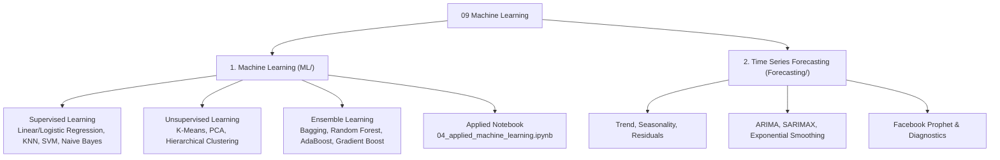

# 09 Machine Learning: Core Algorithms & Time Series Forecasting

> **Module Focus:** Supervised Learning · Unsupervised Learning · Ensemble Methods · Scikit-Learn API · Time Series Forecasting (ARIMA, SARIMAX, Prophet)

---

## 📖 Overview

Machine Learning enables computational systems to discover patterns in empirical data and make accurate predictions on unseen observations without being explicitly programmed. This module organizes machine learning into two comprehensive domains:
1. **[ML/ — Classical & Ensemble Machine Learning](./ML):** Supervised regression/classification, clustering, dimensionality reduction, ensemble architectures (Random Forest, Gradient Boosting, XGBoost), and practical Scikit-Learn workflows.
2. **[Forecasting/ — Time Series Analysis & Forecasting](./Forecasting):** Temporal patterns, stationarity, decomposition, autocorrelation (ACF/PACF), statistical models (ARIMA, SARIMA), and Facebook Prophet.



---

## 📂 Subfolder Structure & Syllabi

### 1. [ML/ — Machine Learning Models & Scikit-Learn](./ML)
* **[Supervised Learning (`models/01_supervised_learning.md`)](./ML/models/01_supervised_learning.md):**
  * Linear Regression, Ridge & Lasso ($L_1$/$L_2$ Regularization).
  * Logistic Regression & Odds Ratios.
  * K-Nearest Neighbors (KNN), Naive Bayes (Gaussian, Multinomial).
  * Support Vector Machines (SVM) & Kernel Trick (RBF, Polynomial).
  * Decision Trees (Information Gain, Entropy, Gini Impurity).
* **[Unsupervised Learning (`models/02_unsupervised_learning.md`)](./ML/models/02_unsupervised_learning.md):**
  * Clustering: K-Means, Elbow Method, Silhouette Analysis, Hierarchical Clustering (Dendrograms), DBSCAN (Density-based).
  * Dimensionality Reduction: Principal Component Analysis (PCA), Explained Variance Ratio, t-SNE.
* **[Ensemble Learning (`models/03_enseble_learning.md`)](./ML/models/03_enseble_learning.md):**
  * Bagging: Bootstrap Aggregating & Random Forests.
  * Boosting: AdaBoost, Gradient Boosting (GBDT), XGBoost, LightGBM, CatBoost.
  * Voting & Stacking classifiers and regressors.
* **[Applied ML Notebook (`models/04_applied_machine_learning.ipynb`)](./ML/models/04_applied_machine_learning.ipynb):**
  * Hands-on end-to-end pipeline: data loading, feature scaling, model training, cross-validation, hyperparameter tuning (`GridSearchCV`), and evaluation metrics.
* **[Scikit-Learn Properties Cheat Sheet (`scikit_learn properties.md`)](./ML/scikit_learn%20properties.md):**
  * In-depth reference for transformers, estimators, pipelines, scoring metrics, and attribute conventions (`_` suffix).

---

### 2. [Forecasting/ — Time Series Analysis & Forecasting](./Forecasting)
* **[Forecasting Guide (`Forecasting/README.md`)](./Forecasting/README.md):**
  * Exhaustive 25KB guide covering Time Series components (Trend, Seasonality, Noise).
  * Stationarity testing: Augmented Dickey-Fuller (ADF) test, Differencing ($d$).
  * Autoregressive (AR) and Moving Average (MA) processes.
  * Autocorrelation Function (ACF) and Partial Autocorrelation Function (PACF) plots for parameter selection $(p, d, q)$.
  * Seasonal ARIMA (SARIMA: $(p, d, q) \times (P, D, Q)_s$) with exogenous regressors (SARIMAX).
  * Facebook Prophet: Additive & Multiplicative seasonality, holiday effects, changepoint detection.
* **[Forecasting Hands-On Notebook (`Forecasting/Forecasting.ipynb`)](./Forecasting/Forecasting.ipynb):**
  * End-to-end practical time-series workflow forecasting real-world data with evaluation metrics (MAE, RMSE, MAPE).

---

## 🎯 How to Use

```bash
# 1. Install dependencies
pip install scikit-learn pandas numpy matplotlib seaborn statsmodels prophet jupyter

# 2. Launch Jupyter Notebook
jupyter notebook

# 3. Explore ML/models/04_applied_machine_learning.ipynb or Forecasting/Forecasting.ipynb
```
