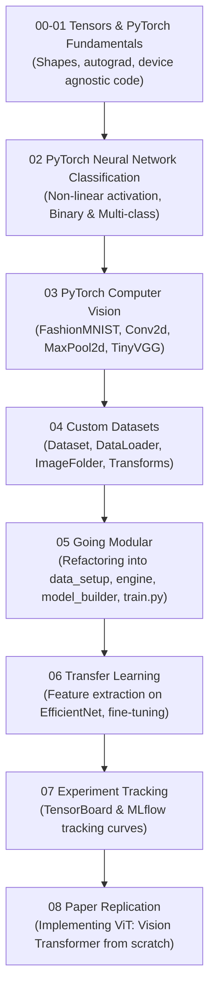

# 10 Deep Learning: PyTorch Deep Learning Curriculum

> **Module Focus:** Tensors · Neural Network Architecture · Computer Vision (CNNs) · Custom Datasets · Modular Python Engine · Transfer Learning · Experiment Tracking · Paper Replication (Vision Transformers / ViT)
>
> 📚 **Reference Curriculum:** Based on the acclaimed [Learn PyTorch for Deep Learning](https://www.learnpytorch.io/) by Daniel Bourke.

---

## 📖 Overview

This module provides a comprehensive, hands-on path through modern Deep Learning using **PyTorch**. It spans from raw tensor operations to building custom Convolutional Neural Networks (CNNs), refactoring code into modular production scripts (`going_modular`), fine-tuning state-of-the-art vision models via Transfer Learning, and replicating published research papers (Vision Transformer / ViT).



---

## 📂 Notebook & Code Index

| Notebook / Script | Topic & Milestones | Key PyTorch APIs |
|---|---|---|
| [`00_Intro_to_tensors.ipynb`](./00_Intro_to_tensors.ipynb) | Tensor basics, indexing, tensor shapes, broadcasting, tensor manipulation (`reshape`, `view`, `stack`, `squeeze`, `unsqueeze`). | `torch.tensor`, `torch.zeros`, `torch.arange` |
| [`01_PyTorch_Fundamentals.ipynb`](./01_PyTorch_Fundamentals.ipynb) | End-to-end linear regression workflow: creating synthetic data, building an `nn.Module`, defining loss (`nn.L1Loss`) & optimizer (`torch.optim.SGD`), the PyTorch training loop, testing loop, and model saving/loading. | `nn.Module`, `nn.Parameter`, `optim.SGD`, `torch.save` |
| [`02_PyTorch_Classification.ipynb`](./02_PyTorch_Classification.ipynb) | Binary and multi-class classification: non-linear activations (`nn.ReLU`, `nn.Sigmoid`), decision boundaries on Circles and Blobs datasets, cross-entropy loss (`nn.BCEWithLogitsLoss`, `nn.CrossEntropyLoss`). | `torch.softmax`, `nn.Sequential` |
| [`03_PyTorch_computer_vision.ipynb`](./03_PyTorch_computer_vision.ipynb) | Computer Vision on FashionMNIST: baseline linear model, adding non-linearity, and building a custom Convolutional Neural Network (CNN / TinyVGG architecture) with `Conv2d` and `MaxPool2d` layers. | `torchvision.datasets`, `nn.Conv2d`, `nn.MaxPool2d` |
| [`04_PyTorch_custom_datasets.ipynb`](./04_PyTorch_custom_datasets.ipynb) | Loading custom image datasets (`pizza_steak_sushi`): writing custom `Dataset` subclasses, using `torchvision.datasets.ImageFolder`, data augmentations (`transforms.Compose`), and managing `DataLoader` batches. | `torchvision.transforms`, `torch.utils.data.DataLoader` |
| [`05_pytorch_going_modular.md`](./05_pytorch_going_modular.md) | Architectural guide on breaking monolithic Jupyter notebooks into reusable, maintainable Python scripts. | Script mode engineering |
| [`going_modular/`](./going_modular) | **Production Modular Codebase:**<br>• `data_setup.py`: Data loaders & transforms.<br>• `model_builder.py`: TinyVGG architecture class.<br>• `engine.py`: `train_step()`, `test_step()`, `train()`.<br>• `utils.py`: Checkpoint saving.<br>• `train.py`: CLI training entry point. | Clean engineering refactoring |
| [`06_PyTorch_transfer_learning.ipynb`](./06_PyTorch_transfer_learning.ipynb) | Transfer Learning: Leveraging pre-trained weights (e.g. `EfficientNet_B0`, `ResNet50`), freezing backbone feature extractor layers, replacing classifier heads, and training on custom data with 10% labels. | `torchvision.models`, `weights=DEFAULT` |
| [`07_PyTorch_experiment_tracking.ipynb`](./07_PyTorch_experiment_tracking.ipynb) | Comparing models and hyperparameter variations using TensorBoard and MLflow tracking curves; choosing optimal trade-off between model size and accuracy. | `torch.utils.tensorboard.SummaryWriter`, `mlflow` |
| [`08_PytTorch_paper_replicating.ipynb`](./08_PytTorch_paper_replicating.ipynb) | Replicating published AI research: Building the **Vision Transformer (ViT)** from *An Image is Worth 16x16 Words* from scratch—Patch Embeddings, Class Token, Positional Embeddings, Multihead Self-Attention, and Transformer Encoder Blocks. | `nn.MultiheadAttention`, `nn.LayerNorm`, ViT architecture |
| [`helper_functions.py`](./helper_functions.py) | Utility functions for accuracy calculation, loss curve plotting, decision boundary visualization, and image un-normalization. | Plotting & Evaluation helpers |
| [`models/`](./models) | Pre-trained model weights checkpoints: `01_pytorch_fundamentals_model_0.pth`, `03_pytorch_computer_vision_model_cnn.pth`. | Saved PyTorch `.pth` weights |
| [`Data/`](./Data) | Datasets: `FashionMNIST/` and `pizza_steak_sushi/` classification data. | Image assets |

---

## 🔁 The Standard PyTorch Training Loop Pattern

Every neural network in PyTorch follows this standardized lifecycle:

```python
# 1. Forward Pass (Compute predictions)
y_pred = model(X_train)

# 2. Calculate Loss
loss = loss_fn(y_pred, y_train)

# 3. Zero Gradients
optimizer.zero_grad()

# 4. Backward Pass (Backpropagation - compute dLoss/dWeight)
loss.backward()

# 5. Optimizer Step (Update model weights via gradient descent)
optimizer.step()
```

---

## 💻 How to Run

```bash
# 1. Install PyTorch ecosystem
pip install torch torchvision torchaudio matplotlib pandas numpy jupyter

# 2. Launch Jupyter Notebook
jupyter notebook

# 3. Train using modular CLI scripts
python going_modular/going_modular/train.py --model_name tinyvgg --num_epochs 10 --batch_size 32 --learning_rate 0.001
```
