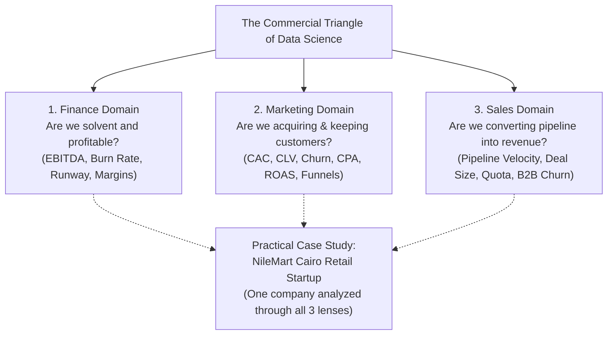

# 11 Business Domain Guides: Finance, Marketing & Sales for Data Science

> **Module Focus:** Commercial Context · Financial Health & Unit Economics · Marketing Metrics & Funnels · Sales Velocity & B2B Pipelines · Startup Case Study

---

## 📖 Overview

A data scientist who only understands algorithms is a liability; a data scientist who understands the business is an indispensable strategic partner. 

Data without business context is meaningless, and machine learning models trained without commercial alignment optimize the wrong objective functions. This module provides reference guides across the three core commercial pillars: **Finance**, **Marketing**, and **Sales**, illustrated with real-world enterprise scenarios.

---

## 📂 Domain Reference Guides

### 1. [Finance Domain Guide](./Finance_Domain_Guide.pdf)
*Assessing profitability, liquidity, financial stability, and cost structures.*
* **What is Finance?** The management, allocation, and optimization of capital, funding, risk, and fiscal compliance.
* **Core Financial Metrics for Data Science:**
  * **Gross Margin:** $\frac{\text{Revenue} - \text{COGS}}{\text{Revenue}} \times 100$. Evaluates unit product efficiency before overhead.
  * **EBITDA (Earnings Before Interest, Taxes, Depreciation, and Amortization):** The pure operational profitability proxy.
  * **Net Income:** The bottom line after all expenses, taxes, and interest.
  * **Burn Rate & Cash Runway:** $\text{Runway (Months)} = \frac{\text{Current Cash Balance}}{\text{Monthly Net Burn Rate}}$. Critical for startups and tech budgeting.
  * **CAPEX vs. OPEX:** Capital expenditures (long-term servers, hardware) vs. Operational expenditures (cloud computing, monthly SaaS).
  * **Risk Management:** Credit risk scoring, fraud detection, and regulatory compliance.

---

### 2. [Marketing Domain Guide](./Marketing_Domain_Guide.pdf)
*Customer acquisition, brand positioning, audience segmentation, and lifecycle retention.*
* **What is Marketing?** The science and strategy of identifying, attracting, satisfying, and retaining profitable customers.
* **Core Marketing Metrics for Data Science:**
  * **Customer Acquisition Cost (CAC):** $\text{CAC} = \frac{\text{Total Marketing \& Sales Spend}}{\text{New Customers Acquired}}$.
  * **Customer Lifetime Value (CLV / LTV):** The total net revenue a customer generates throughout their relationship.
  * **The Golden CLV:CAC Ratio:**
    * $< 1:1$ $\to$ Business is burning cash to lose money.
    * $1:1$ to $2:1$ $\to$ Borderline / unprofitable after overhead.
    * **$3:1$ to $5:1$ $\to$ The Healthy Enterprise Benchmark.**
    * $> 5:1$ $\to$ Under-investing in growth; marketing budget can be aggressively increased.
  * **Cost Per Acquisition (CPA):** Channel-specific cost to drive a discrete conversion event.
  * **Return on Ad Spend (ROAS):** $\frac{\text{Revenue Generated from Ads}}{\text{Total Ad Spend}}$.
  * **Customer Churn Rate:** Percentage of customers who cancel or cease buying over a given timeframe.

---

### 3. [Sales Domain Guide](./Sales_Domain_Guide.pdf)
*Pipeline management, deal velocity, lead qualification, and enterprise revenue execution.*
* **What is Sales?** The commercial engine responsible for directly engaging prospects, overcoming objections, negotiating contracts, and closing revenue.
* **Core Sales Metrics for Data Science:**
  * **Sales Pipeline Stages:** Lead Generation $\to$ Qualified Lead (MQL/SQL) $\to$ Discovery & Demo $\to$ Proposal / Quote $\to$ Negotiation $\to$ Closed-Won / Closed-Lost.
  * **Sales Velocity Equation:**
    $$\text{Sales Velocity} = \frac{\text{Number of Opportunities} \times \text{Win Rate (\%)} \times \text{Average Deal Size}}{\text{Sales Cycle Length (Days)}}$$
  * **Average Order Value (AOV) / Average Deal Size:** Revenue per transaction.
  * **Quota Attainment:** Percentage of sales reps hitting their quarterly revenue targets.
  * **B2B Account Health & Churn Watch:** Identifying at-risk enterprise accounts before contract renewal.

---

### 4. [Practical Domain Examples: NileMart Retail Startup](./Domain_Practical_Examples.pdf)
*A Cairo-based omni-channel retail startup analyzed through all three lenses:*
1. **The Financial Lens:**
   * Evaluating NileMart's monthly revenue (1,200,000 EGP), Gross Margin (38%), EBITDA margin, and Net Burn Rate (180,000 EGP/month) to calculate remaining cash runway (11.5 months).
2. **The Marketing Lens:**
   * Marketing spend (120,000 EGP) yielding 600 new buyers ($\text{CPA} = 200\text{ EGP}$).
   * Comparing NileMart's $\text{CLV} = 2,400\text{ EGP}$ against $\text{CAC} = 200\text{ EGP}$ ($\text{CLV:CAC} = 12:1$).
   * Diagnosing a **$28\%$ monthly churn rate**—revealing that while NileMart is acquiring users cheaply, it is hemorrhaging customers due to fulfillment delays.
3. **The Sales Lens:**
   * B2B corporate office catering accounts: tracking 18 accounts that went inactive ("quiet accounts") and triggering a 48-hour retention outreach playbook.
   * Territory expansion modeling for New Cairo corporate parks.

---

## 🎯 Key Takeaway for Data Scientists
> When presenting model findings to executive stakeholders, **never report only accuracy or F1-score**.  
> Translate metrics into commercial impact:  
> *"Improving our model's precision by 4% reduces false-positive fraud declines, preserving \$240,000 in monthly Gross Merchandise Value (GMV) and reducing customer churn by 1.8%."*
