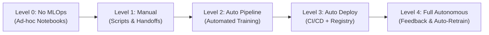

# Module 01: From Code to Container

> **Core Theme:** Packaging · FastAPI · Serialization · Docker · pytest · Structured Logging  
> **Source Session:** MLOps Engineering Session 1 of 5 (Aya Nasser Salama, MLOps MENA Community)

---

## 1. The MLOps Maturity Model

A diagnostic framework to evaluate where an engineering team stands and determine the next concrete milestone:



| Level | Name | Process | Reproducibility | Deployment | Monitoring |
|---|---|---|---|---|---|
| **0** | **No MLOps** | 100% manual in Jupyter notebooks. No tracking. | None. "Works on my machine". | Manual copy-pasting of weights/code. | None. Business discovers broken models weeks later. |
| **1** | **Manual Pipeline** | Modular Python scripts. Separate training and feature steps. | Low to moderate. Tracked via git branches. | Manual deployment to servers/VMs. | Basic infrastructure metrics only (CPU, RAM). |
| **2** | **Automated Training** | Pipeline runs automatically on new data (Airflow, Kubeflow). | High. Data versioned (DVC), params tracked (MLflow). | Semi-automated. Human approval required to push model. | Basic model performance metrics. |
| **3** | **Automated CI/CD** | Full CI/CD triggers linting, testing, Docker builds, and deployment. | Complete audit trail connecting Code + Data + Model. | Automated zero-downtime deployment (Canary, Blue/Green). | Prometheus + Grafana dashboards for latency and errors. |
| **4** | **Full Autonomous MLOps** | Self-healing pipelines with drift-triggered auto-retraining. | 100% deterministic, immutable artifacts. | Automated shadow mode rollout and champion/challenger swaps. | Real-time data & concept drift detection with automated rollback. |

---

## 2. The Notebook Problem: Why 87% of Models Never Reach Production

Jupyter Notebooks are exceptional for **Exploratory Data Analysis (EDA)**, but disastrous as production artifacts:
1. **Hidden State & Out-of-Order Execution:** Cells can be executed in arbitrary order. Running cell 15 before cell 3 leaves invisible in-memory mutations that cannot be reproduced.
2. **No API Boundary:** A notebook cannot be queried over HTTP by client applications or microservices.
3. **Untestable:** Unit testing, mocking, and coverage analysis are virtually impossible on `.ipynb` JSON files.
4. **Dependency Hell:** Notebooks rarely declare pinned dependencies, relying on whatever was installed in the local conda environment.

**The Solution:** Transition from notebooks to a structured **Python package (`src/` layout)** with strict API contracts.

---

## 3. Python Packaging & Project Structure

A production-ready repository separates application logic, configuration, testing, and scripts:

```
01_Packaging_FastAPI_Docker/
├── pyproject.toml              # Modern build-system & dependency configuration
├── Dockerfile                  # Multi-stage production container build
├── docker-compose.yml          # Local multi-service orchestration
├── .dockerignore               # Container build exclusion rules
├── src/
│   ├── __init__.py             # Package marker
│   ├── config.py               # Pydantic BaseSettings environment loader
│   ├── logger.py               # Structured JSON logging with Correlation IDs
│   ├── schemas.py              # Pydantic v2 input/output boundary schemas
│   ├── model.py                # Abstract Base Class model wrapper (Sklearn & ONNX)
│   └── app.py                  # Production FastAPI application with lifespan management
├── scripts/
│   ├── train_and_export.py     # Training script exporting to .joblib & .onnx
│   └── benchmark_serialization.py # Latency and payload size comparison
└── tests/
    ├── conftest.py             # Pytest fixtures and TestClient initialization
    ├── test_api.py             # API endpoint contracts and 422 validation tests
    └── test_model.py           # Unit tests for preprocessing and predictions
```

### Why `pyproject.toml` over `setup.py` / `requirements.txt`?
- **PEP 518 & PEP 621 Standard:** Consolidates metadata, build requirements, dependencies, and tool configs (Ruff, Pytest, Black) into a single declarative file.
- **Reproducible Installs:** Enables editable development mode:
  ```bash
  pip install -e .
  ```

---

## 4. Serving ML with FastAPI

FastAPI is the standard Python web framework for ML inference due to:
- **Asynchronous Coroutines (`async/await`):** High concurrency for I/O-bound requests.
- **Pydantic Validation:** Inbound JSON is validated against strict types before touching model code.
- **Automatic OpenAPI Documentation:** Interactive Swagger UI generated automatically at `/docs`.

### The Lifespan Context Manager Pattern
Never load model weights inside endpoint functions—loading on every request multiplies latency by $1000\times$. Always use `@asynccontextmanager`:

```python
@asynccontextmanager
async def lifespan(app: FastAPI):
    # STARTUP: Load heavy weights once into memory
    app.state.model = SklearnModelWrapper()
    app.state.model.load(settings.MODEL_PATH)
    yield
    # SHUTDOWN: Clean up resources / GPU memory
```

---

## 5. Model Serialization Showdown

How should you serialize and export trained machine learning models?

| Format | Speed | Size | Language Support | Security Risk | Production Verdict |
|---|---|---|---|---|---|
| **JSON** | Slow ($5\times$ slower) | Large (text) | Universal | Zero risk | Best for HTTP API payloads |
| **Pickle / Joblib** | Fast | Medium | Python only | **High** (`pickle.loads` executes arbitrary code) | Good for local dev; dangerous if untrusted |
| **ONNX Runtime** | **Ultra Fast ($3–10\times$ faster)** | **Compact binary** | Multi-language (C++, Java, Go, Python) | **Zero (Safe Graph)** | **Industry Gold Standard for Serving** |
| **Protobuf / FlatBuffers** | Ultra Fast | Minimal binary | Universal | Zero | Ideal for internal microservice gRPC |

### What is ONNX (Open Neural Network Exchange)?
ONNX converts model compute graphs (from PyTorch, Scikit-Learn, XGBoost, or TensorFlow) into an optimized intermediate representation. The **ONNX Runtime (ORT)** executes this graph using C++ with automatic SIMD, AVX-512, and GPU acceleration.

---

## 6. Production Docker & Containerization

### Multi-Stage Dockerfile Strategy
Using a single-stage Dockerfile includes GCC, build headers, and package caches in your final image, swelling the size to >1.5 GB. 

A **Multi-Stage Build**:
1. **Builder Stage (`AS builder`):** Installs build tools, compiles C extensions, builds wheels.
2. **Runtime Stage:** Copies only the pre-compiled virtual environment. Runs under an **unprivileged user (`USER appuser`, UID 10001)** for container security compliance.
3. **Result:** Image size reduced by ~70%, vulnerabilities drastically minimized.

---

## 7. Structured JSON Logging & Observability

Why replace `print()` with structured JSON logging?
- Standard stdout `print("Pred:", y)` is impossible to query in log aggregators (Elasticsearch, CloudWatch, Datadog).
- **Structured JSON Logs** emit key-value pairs indexed automatically:
  ```json
  {
    "timestamp": "2026-10-24T12:00:00Z",
    "level": "INFO",
    "request_id": "c9bf9e57-1685-4c89-bafb-ff5af830be8a",
    "method": "POST",
    "path": "/predict",
    "status_code": 200,
    "latency_ms": 3.42,
    "model_version": "v1.0.0-sklearn"
  }
  ```
- **Correlation ID (`X-Request-ID`):** Passed in HTTP headers or generated on entry, linking all log entries for a single request across distributed microservices.

---

## 8. Unit Testing with pytest

Every production ML service requires a minimum of **80% test coverage**:
- **Endpoint Tests:** Verify `/health` reports model readiness; verify `/predict` responds with valid 200 payloads.
- **Boundary Validation Tests:** Verify invalid inputs (e.g., negative trip distance, non-existent TLC zone IDs) trigger HTTP 422 Unprocessable Entity instead of crashing the server with 500.
- **Model Wrapper Unit Tests:** Verify preprocessing returns the correct float32 matrix shape `(1, 6)`.

---

## 9. Quickstart Guide: Running the Service

### 1. Run with Python Locally
```bash
# 1. Install dependencies
pip install -e .

# 2. Train baseline model (optional; service includes heuristic fallback)
python scripts/train_and_export.py

# 3. Run the FastAPI application
python src/app.py
```
Open your browser to `http://localhost:8000/docs` to test endpoints via Swagger UI.

### 2. Run Test Suite
```bash
pytest --cov=src --cov-report=term-missing
```

### 3. Run with Docker Compose
```bash
docker compose up --build
```
Check health:
```bash
curl http://localhost:8000/health
```
Send a prediction:
```bash
curl -X POST http://localhost:8000/predict \
     -H "Content-Type: application/json" \
     -d '{
       "pickup_location_id": 43,
       "dropoff_location_id": 142,
       "trip_distance": 3.75,
       "passenger_count": 1,
       "hour_of_day": 14,
       "day_of_week": 2
     }'
```
