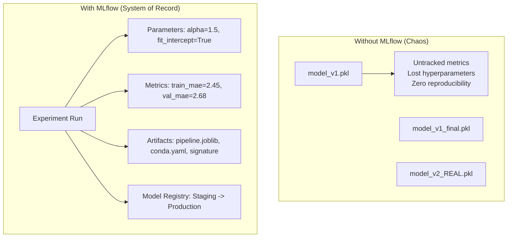
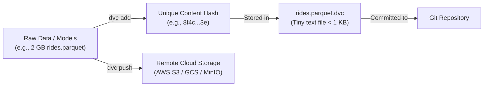

# Module 02: Shipping to Production & CI/CD

> **Core Theme:** MLflow · Weights & Biases · DVC · Ruff · Terraform · GitHub Actions · Integration Testing  
> **Source Session:** MLOps Engineering Session 2 of 5 (Aya Nasser Salama, MLOps MENA Community)

---

## 1. Why MLflow? Solving the "model_v2_final_REAL.pkl" Chaos

Without a systematic experiment tracker, machine learning teams inevitably fall into chaos:
- `model_v1.pkl`, `model_v1_final.pkl`, `model_v2_fixed_real.pkl`
- Which dataset trained which model?
- What were the hyperparameters?
- Why did last Tuesday's model score higher on test than today's?



### The 4 Pillars of MLflow
1. **MLflow Tracking:** Centralized server capturing code version (git commit), parameters, metrics history across epochs, tags, and output files.
2. **MLflow Models:** Standard packaging flavor with **Model Signatures** (`infer_signature(X_sample, y_pred)`) specifying expected tensor input types and output dimensions.
3. **MLflow Model Registry:** Full lifecycle governance. Models move through semantic aliases/stages (`Staging` $\to$ `Production` $\to$ `Archived` or modern `@champion` and `@challenger`).
4. **MLflow Projects:** Standard descriptor (`MLproject`) defining reproducible runtime environments (Docker/Conda).

---

## 2. MLflow vs. Weights & Biases (W&B)

| Feature | MLflow | Weights & Biases (W&B) |
|---|---|---|
| **Hosting** | 100% Open Source, Self-Hosted (PostgreSQL + S3) | Cloud-Native SaaS (On-prem enterprise available) |
| **Model Registry** | **Native & Powerful** (First-class stages & aliases) | Artifacts lineage & registry |
| **Hyperparameter Sweeps** | Basic (or requires external Optuna/Hyperopt) | **Best-in-Class Native Sweeps** (Bayesian, visual parallel coords) |
| **Best Used For** | Core enterprise registry, self-hosted data governance | Collaborative research, deep learning sweeps, LLM evaluation |

---

## 3. Data Version Control (DVC): Git for Datasets & Models

### Why Git Cannot Store Data
- Git compresses and computes delta diffs across the entire file tree. Storing a 500 MB `.parquet` or `.csv` file in Git bloats the `.git` directory permanently, slowing down clones and pulls.
- GitHub hard limits file uploads to **100 MB** and rejects pushes with large files.

### How DVC Solves It


1. Data files are hashed with MD5.
2. A lightweight pointer file (`.dvc`) is committed to Git.
3. The heavy data blob is pushed to remote storage via `dvc push` and retrieved via `dvc pull`.

### The Three-Way Lineage Contract
To reproduce any past prediction in production, an MLOps engineer tracks the trinity:
$$\text{Production Prediction} \longleftrightarrow \text{Git Commit (Code)} \longleftrightarrow \text{DVC Hash (Data)} \longleftrightarrow \text{MLflow Run ID (Model Artifact)}$$

---

## 4. DVC Pipelines: Declarative Reproducibility (`dvc.yaml`)

A pipeline is defined as a Directed Acyclic Graph (DAG) connecting stages:
- **`prepare`:** Ingests raw data $\to$ cleanses $\to$ generates `train.parquet` and `val.parquet`.
- **`train`:** Ingests `train.parquet` $\to$ fits model $\to$ logs to MLflow $\to$ outputs `models/pipeline.joblib`.
- **`evaluate`:** Ingests `val.parquet` & `models/pipeline.joblib` $\to$ validates performance gate $\to$ outputs `metrics.json`.

Run the entire pipeline with automatic caching:
```bash
dvc repro
```
If `prepare.py` and raw data haven't changed, DVC skips stage 1 and runs only downstream stages!

---

## 5. Code Quality: Ruff & Pre-Commit

### Ruff: The High-Speed Rust Linter & Formatter
Replaces Flake8, Black, isort, and pyupgrade in a single binary that runs $100\times$ faster.
```bash
ruff check . --fix
ruff format .
```

### Pre-Commit Hooks
Configured in `.pre-commit-config.yaml`. Runs automatically before every `git commit`:
- Rejects files exceeding **50 MB** (`check-added-large-files`), completely preventing GitHub push rejections.
- Auto-fixes formatting and import sorting via Ruff.
- Checks YAML and JSON syntax integrity.

---

## 6. Infrastructure as Code (Terraform)

Production MLOps infrastructure should never be clicked together in a cloud web console.
Using declarative Terraform files (`terraform/main.tf`):
- Provisions AWS S3 Bucket for DVC remote data and MLflow artifacts.
- Enforces **S3 Bucket Object Versioning** for complete data auditability.
- Enforces **AES256 Server-Side Encryption**.
- Provisions **DynamoDB State Locking** to prevent concurrent Terraform state corruption.

```bash
cd terraform
terraform init
terraform plan
terraform apply
```

---

## 7. CI/CD with GitHub Actions & CML

### 1. Continuous Integration (`.github/workflows/ci.yml`)
Runs on every Pull Request:
1. **Lint Job:** Ruff validates syntax and formatting standards.
2. **Test Job:** Runs `pytest` unit and integration tests.
3. **Build Job:** Builds multi-stage Docker container and pushes to Docker Hub with Git SHA tags.

### 2. Continuous Machine Learning (`.github/workflows/cml_train.yml`)
Automates retraining on a schedule (e.g. weekly cron):
1. Pulls latest data via DVC.
2. Runs pipeline retraining (`python src/prepare.py && python src/train_mlflow.py && python src/evaluate.py`).
3. Uses **CML (Continuous Machine Learning)** to generate a markdown comparison table directly in the PR comments.

---

## 8. Integration Testing Strategy

Unit tests mock external dependencies. **Integration Tests (`tests/test_integration.py`)**:
- Execute the full pipeline sequentially (`prepare` $\to$ `train` $\to$ `evaluate`).
- Assert that `metrics.json` is created with valid metric ranges ($R^2 > 0$, $\text{MAE} < 3.5$).
- Verify that the exported model artifact can be unpickled and produces valid vector predictions.
- Validate data schema contracts (`tests/test_contracts.py`).

---

## 9. Quickstart Guide

```bash
# 1. Run data preparation
python src/prepare.py

# 2. Run model training with MLflow tracking
python src/train_mlflow.py

# 3. Run evaluation & quality gate
python src/evaluate.py

# 4. Run full integration test suite
pytest -v
```
