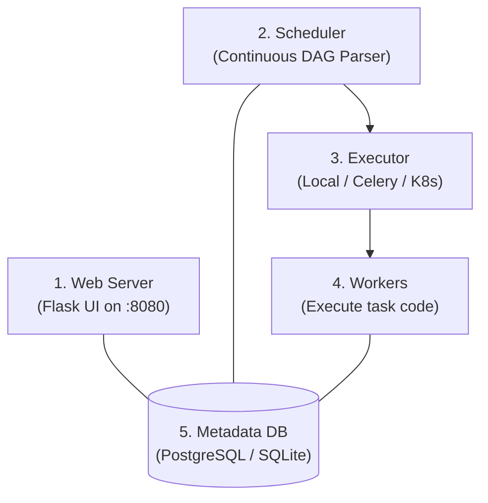
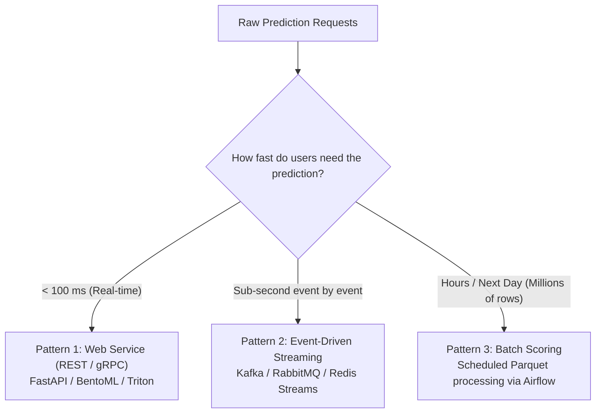
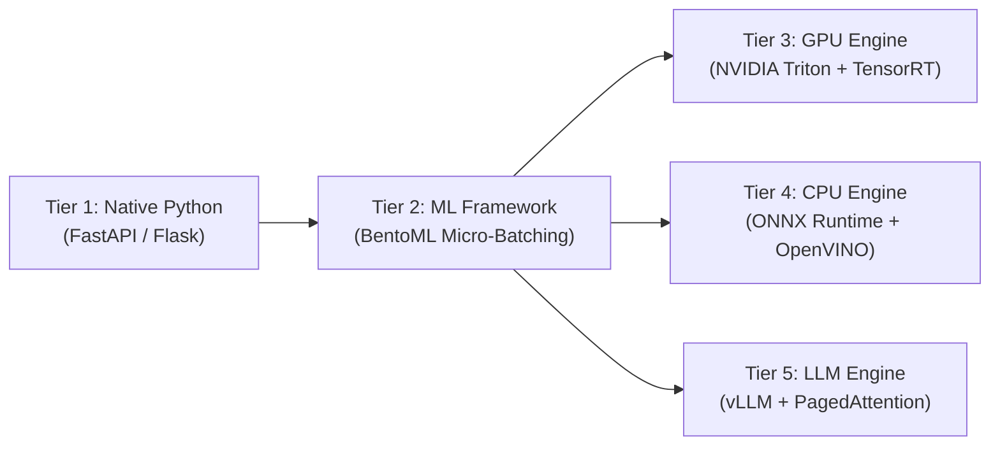
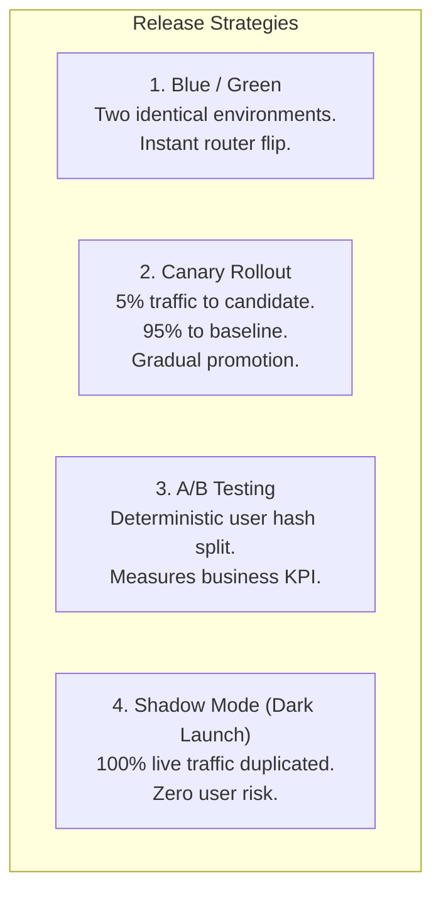

# Module 03: Orchestration, Model Serving & Rollout Strategies

> **Core Theme:** Apache Airflow · 3 Inference Patterns · 5-Tier Serving Progression · Locust · Canary & Shadow Releases  
> **Source Session:** MLOps Engineering Session 3 of 5 (Aya Nasser Salama, MLOps MENA Community)

---

## 1. Orchestration with Apache Airflow

A shell script running under a Linux `cron` job is not an enterprise pipeline:
- **No retry with exponential backoff:** If an external S3 bucket experiences network lag, `cron` silently terminates and drops the job.
- **No dependency modeling:** Step 3 starts running even if Step 1 failed to download data.
- **No observability:** Zero UI to inspect execution logs, task durations, or trigger manual backfills.

### Airflow 5-Component Architecture


1. **Web Server:** Visual dashboard for inspecting DAG runs, logs, and task status.
2. **Scheduler:** Continuously parses DAG files, schedules runs, and monitors task dependencies.
3. **Executor:** The mechanism determining *how* work is dispatched (Sequential, Local, Celery, Kubernetes).
4. **Worker Processes:** The machines executing the task functions.
5. **Metadata Database:** Single source of truth storing state, variables, and connection credentials.

### Airflow Best Practices for ML Engineers
- **Keep heavy imports inside the task callable:** Python DAG files are parsed by the Airflow Scheduler every 30 seconds. Importing PyTorch or TensorFlow at the module top level degrades scheduler performance.
- **Always set `catchup=False`:** Prevents Airflow from triggering hundreds of backfill runs for every historical interval since `start_date` when initializing a pipeline.
- **Tasks must be idempotent:** If a worker crashes and Airflow retries a task, running it twice must produce identical results without duplicating rows.

---

## 2. The 3 Inference Patterns

Choosing the wrong inference pattern wastes thousands of dollars in cloud computing costs or causes unacceptable latency.



| Inference Pattern | Latency | Throughput | Cost Efficiency | Example Use Case |
|---|---|---|---|---|
| **Web Service (REST / gRPC)** | **Low (< 50 ms)** | Moderate | Medium (idle compute costs) | Ride hailing price estimate, fraud check at checkout |
| **Batch Scoring** | High (Minutes to Hours) | **Extreme (Millions/sec)** | **Highest (Spins down when done)** | Weekly customer churn scoring, overnight marketing email rankings |
| **Event-Driven Streaming** | **Very Low (< 10 ms)** | High (Event streams) | Moderate | IoT sensor anomaly detection, real-time clickstream recommendations |

---

## 3. The 5-Tier Model Serving Progression

How do enterprise teams evolve their serving infrastructure as scale increases?



### Tier 1: Native Python (FastAPI)
- **Pros:** Fast to develop, familiar Python ecosystem.
- **The Bottlenecks:** Python Global Interpreter Lock (GIL) serializes CPU threads; lacks request queuing and micro-batching. Under 100 concurrent users, latency degrades exponentially.

### Tier 2: ML Framework Serving (BentoML)
- **Key Innovation: Adaptive Micro-Batching.** BentoML queues independent HTTP requests arriving within a short window (e.g. 10 ms) up to a max batch size (e.g. 32) and sends them to the model as a vectorized batch.
- Separates API workers from Model Runner processes.

### Tier 3: GPU Acceleration (NVIDIA Triton Inference Server)
- Industry standard for GPU serving: written in C++, supports PyTorch, ONNX, and TensorRT.
- Features **Dynamic Batching** configured via `config.pbtxt` (`max_queue_delay_microseconds: 5000`).

### Tier 4: CPU Acceleration (ONNX Runtime + Intel OpenVINO)
- Achieves sub-5 ms latency on cheap cloud CPU instances using SIMD, AVX-512, and constant folding.

### Tier 5: Large Language Model Serving (vLLM)
- Traditional serving wastes 60–80% of GPU VRAM on KV cache memory fragmentation.
- **PagedAttention:** Allocates non-contiguous physical memory blocks like OS virtual memory.
- **Continuous Batching:** Injects new requests into ongoing token generation iterations without waiting for prior requests to finish.

---

## 4. Load Testing with Locust

Never release a model without stress testing its saturation limit:
- **`locustfile.py`:** Defines simulated user behavior with `@task` decorators and realistic input randomization.
- **Key Metrics to Track:**
  - **p50 Latency:** Median response time under load.
  - **p95 / p99 Latency:** Tail latency experienced by the slowest 5% and 1% of users.
  - **Requests Per Second (RPS):** System throughput.
  - **Failure Rate:** Must remain at 0.00%.

Run a 100-user ramp test:
```bash
locust -f load_testing/locustfile.py --headless --host http://localhost:8000 --users 100 --spawn-rate 10 --run-time 60s
```

---

## 5. Production Release Strategies

Deploying a newly trained model directly to 100% of live users is a recipe for outages.



### 1. Blue/Green Deployment
- Maintain two identical production environments (Blue and Green).
- Router points to Blue. Deploy new model to Green and run health checks.
- Instantly switch router to Green. If an issue occurs, flip back in 1 second.

### 2. Canary Deployment (`release_strategies/nginx_canary.conf`)
- Route **5% of traffic** to the new model (Canary) and **95%** to the incumbent model.
- Monitor error rates, latencies, and prediction distributions for 2 hours.
- If stable, graduate to 25% $\to$ 50% $\to$ 100%.

### 3. A/B Testing (`release_strategies/ab_testing_router.py`)
- Split users deterministically based on `hash(user_id) % 100`.
- Ensures the same user gets a consistent experience while measuring conversion/CTR differences between algorithms.

### 4. Shadow Mode / Dark Launch (`release_strategies/shadow_mode_proxy.py`)
- Live user requests are answered by the Production model.
- The proxy **asynchronously duplicates** the request to the Candidate model in a background task.
- Compares predictions and logs prediction drift **with zero user-facing risk**.

---

## 6. Directory Structure & Quickstart

```
03_Orchestration_Serving_Deployment/
├── dags/
│   └── ride_duration_retraining_dag.py # Full Airflow retraining DAG
├── patterns/
│   ├── 01_web_service_bentoml/         # BentoML micro-batching service
│   ├── 02_batch_scoring/               # High-throughput Parquet batch scorer
│   └── 03_streaming_kafka/             # Real-time event producer & consumer
├── serving_optimization/
│   ├── triton/                         # NVIDIA Triton config & gRPC client
│   ├── cpu_onnx_openvino/              # CPU accelerated inference
│   └── vllm_llm_serving/               # vLLM serving & token streaming client
├── load_testing/
│   └── locustfile.py                   # Locust load test scenario
├── release_strategies/
│   ├── nginx_canary.conf               # 95/5 Nginx canary traffic proxy
│   ├── blue_green_deploy.py            # Blue/Green switcher
│   ├── ab_testing_router.py            # Deterministic user hash A/B router
│   └── shadow_mode_proxy.py            # Dark launch shadow mode proxy
└── tests/
    └── test_serving.py                 # Serving & routing test suite
```

### Run Tests
```bash
pytest -v
```
