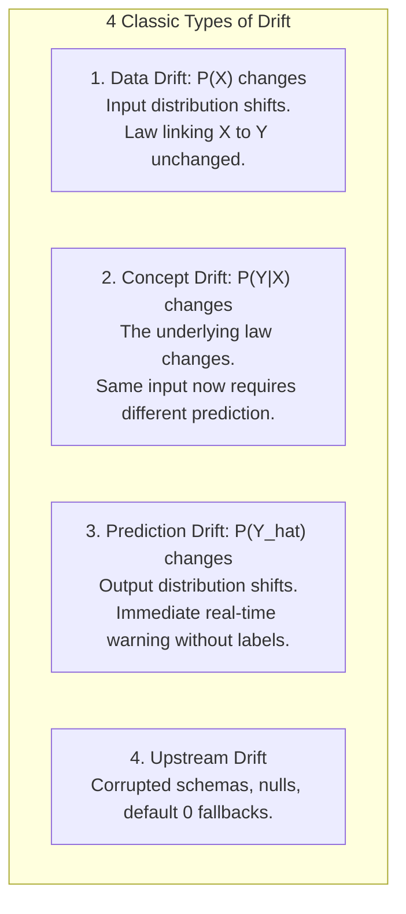
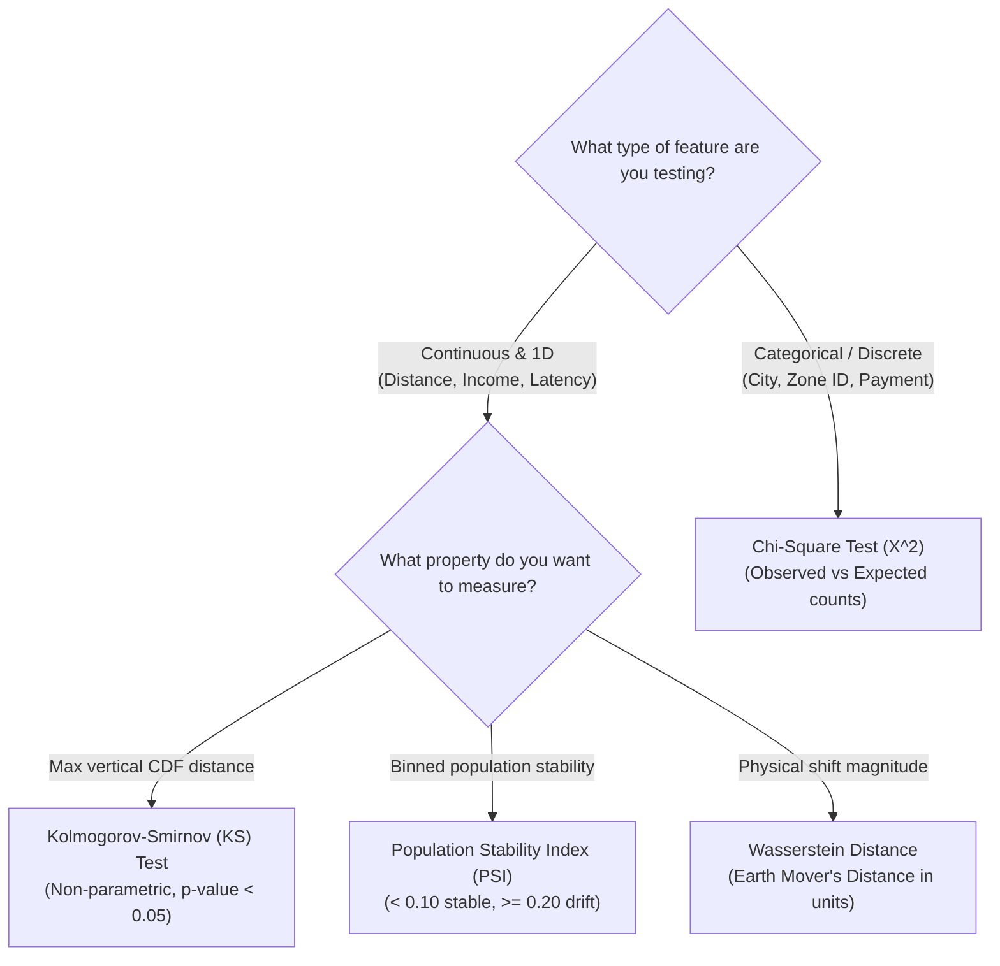
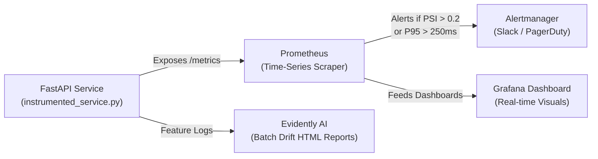
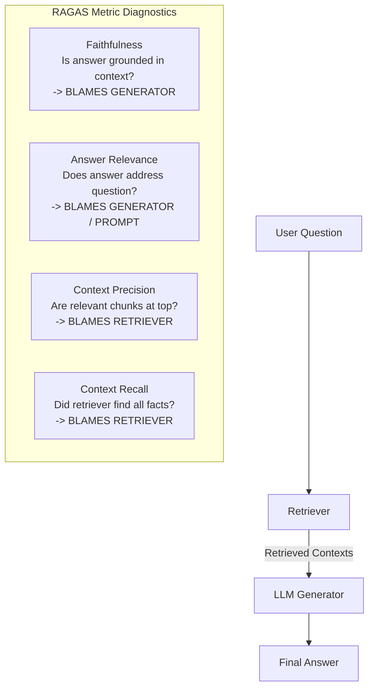

# Module 04: Monitoring, Observability & LLM Evaluation

> **Core Theme:** Drift Taxonomy · Statistical Tests · Prometheus & Grafana · Incident RCA · Langfuse · RAGAS · Runbooks  
> **Source Session:** MLOps Engineering Session 4 of 5 (Aya Nasser Salama, MLOps MENA Community)

---

## 1. The Fundamental Problem: Software Fails Loudly, Models Fail Quietly

In traditional software engineering, an outage is noisy:
- `500 Internal Server Error`
- Error rate spikes on the monitoring dashboard
- Pager fires in 30 seconds; engineering responds within minutes.

In machine learning engineering, a model failure is **silent**:
- `200 OK` on every request.
- Latency is normal (20 ms). CPU and memory are green.
- **The predictions are catastrophically wrong**, and no traditional software monitoring tool notices.
- Industry average delay before detection: **2 to 4 weeks** (usually discovered when business KPIs or revenue collapse).

Monitoring is not an optional extra—it is the **only safeguard** that alerts you when a deployed model ceases doing its job.

---

## 2. Drift Taxonomy: The 4 Classic Kinds of Shift

Let $X$ represent input features, $Y$ represent the true real-world label, and $\hat{Y}$ represent the model's prediction:



| Drift Type | Mathematical Definition | Real-World Example | How It Is Detected |
|---|---|---|---|
| **Data Drift** | $P(X)$ changes, $P(Y\|X)$ constant | A fraud model trained on domestic users suddenly gets 40% international traffic. | Two-Sample KS-Test, Population Stability Index (PSI). |
| **Concept Drift** | $P(Y\|X)$ changes | Inflation or COVID loan moratorium breaks correlation between income and loan default. | Ground truth label performance tracking; Challenger shadow evaluation. |
| **Prediction Drift** | $P(\hat{Y})$ changes | Credit approval model normally approves 15% of applicants, suddenly approves 45%. | Output histogram percentiles in Prometheus (detectable in real time). |
| **Upstream Drift** | Schema / pipeline bug | Data warehouse migrates column `promo_flag` to `is_promo`; missing value defaults to 0. | Pydantic strict schemas, Great Expectations contracts. |

---

## 3. The 8 LLM, RAG & Agentic Drift Types

Large Language Model systems introduce 8 unique drift modes that do not exist in classical machine learning:

1. **Prompt Drift:** End users evolve their query phrasing, prompt length, or language mix over time.
2. **Hallucination Drift:** Model begins asserting ungrounded facts not present in reference documentation.
3. **Retrieval Drift:** The knowledge base is updated, but old chunks remain in the vector database, returning obsolete or contradictory context.
4. **Latency Drift:** Time-To-First-Token (TTFT) or generation slows down as conversation history grows.
5. **Cost & Token Drift:** Average token count per conversation grows exponentially due to multi-turn memory accumulation.
6. **Embedding Drift:** A new embedding model version is deployed without re-indexing all historical vectors in the vector DB.
7. **Tool / Trajectory Drift:** An autonomous agent begins failing JSON function schemas or enters infinite tool-calling loops.
8. **Evaluator / Judge Drift:** When using LLM-as-a-Judge, the judge model's evaluation standards drift across API model updates.

---

## 4. Statistical Tests for Drift Detection

How do you statistically prove that two distributions moved?



### 1. Population Stability Index (PSI)
$$\text{PSI} = \sum_{i=1}^k \left(\text{Actual}_i - \text{Expected}_i\right) \times \ln\left(\frac{\text{Actual}_i}{\text{Expected}_i}\right)$$
- **$\text{PSI} < 0.10$:** Stable distribution. No action required.
- **$0.10 \le \text{PSI} < 0.20$:** Moderate shift. Investigate features; prepare retraining.
- **$\text{PSI} \ge 0.20$:** Significant drift. Trigger alert; retrain model.

### 2. Kolmogorov-Smirnov (KS) Test
Measures the maximum vertical distance $D$ between the empirical CDFs of baseline and production data. If $p < 0.05$, reject the null hypothesis of identical distributions.

### 3. Chi-Square Goodness-of-Fit
Compares observed categorical frequency counts against baseline expectations.

### 4. Wasserstein Distance (Earth Mover's Distance)
Measures the minimum work (mass $\times$ distance) required to transform one distribution into another. Expressed in original feature units (e.g., "trip distance shifted by 2.3 miles").

---

## 5. The Observability Stack: Prometheus, Grafana & Evidently AI



- **Prometheus (`observability_stack/prometheus.yml`):** Scrapes metric counters, histograms, and gauges from `/metrics` every 15 seconds.
- **Alert Rules (`observability_stack/alerts.yml`):**
  - **Latency:** P95 inference latency $> 250\text{ms}$ for $> 2\text{ minutes}$.
  - **Error Rate:** HTTP 5xx errors $> 1\%$ for $> 1\text{ minute}$.
  - **Data Drift:** PSI score $> 0.20$ for $> 10\text{ minutes}$.
- **Evidently AI (`drift_detection/evidently_monitoring_suite.py`):** Generates batch data drift reports, column-by-column drift breakdowns, and interactive HTML dashboards.

---

## 6. LLM Observability with Langfuse

Langfuse provides open-source observability, prompt management, and evaluation for LLM applications:
1. **Hierarchical Traces:**
   - **Trace:** The overall user transaction.
   - **Span:** Internal micro-operations (vector DB query, preprocessing).
   - **Generation:** LLM prompt, completion, token count, and financial cost.
2. **Centralized Prompt Management:**
   - Prompts are code configurations: versioned, tagged (`production`, `staging`), and updated without re-deploying microservices.
3. **Scores & Evaluations:** Attaches programmatic evaluations (RAGAS) or end-user feedback (thumbs up/down) directly to individual traces.

---

## 7. RAG Evaluation with RAGAS

RAGAS (Retrieval Augmented Generation Assessment) isolates whether a bad answer was caused by the **Retriever** or the **LLM Generator**:



- **Faithfulness:** $\frac{\text{Claims supported by context}}{\text{Total claims in answer}}$. If low $\to$ Hallucination.
- **Context Precision:** Evaluates if relevant chunks are placed at rank 1 and 2 instead of buried at rank 5.
- **Context Recall:** $\frac{\text{Ground truth facts in context}}{\text{Total ground truth facts}}$. If low $\to$ Retriever missed critical information.

---

## 8. Directory Structure & Quickstart

```
04_Monitoring_Observability_LLMOps/
├── drift_detection/
│   ├── statistical_drift_tests.py     # Applied KS-test, PSI, Chi-Square, Wasserstein
│   └── evidently_monitoring_suite.py  # Evidently AI / fallback drift reports
├── observability_stack/
│   ├── prometheus.yml                 # Prometheus scrape config
│   ├── alerts.yml                     # Prometheus alert rules (P95, 5xx, PSI)
│   └── instrumented_service.py        # FastAPI service instrumented with Prometheus
├── real_world_incidents/
│   └── incident_postmortems.md        # 4 Documented incident root cause analyses
├── llm_observability_langfuse/
│   └── langfuse_tracer.py             # Langfuse tracing, spans & prompt management
├── rag_evaluation_ragas/
│   └── ragas_evaluator.py             # RAGAS metrics evaluation harness
├── interview_prep_and_runbooks/
│   ├── mlops_interview_handbook.md    # 12 Deep architectural Q&As
│   └── incident_response_runbook.md   # Step-by-step incident response playbook
└── tests/
    └── test_monitoring.py             # Drift and RAGAS unit test suite
```

### Run Tests
```bash
pytest -v
```
