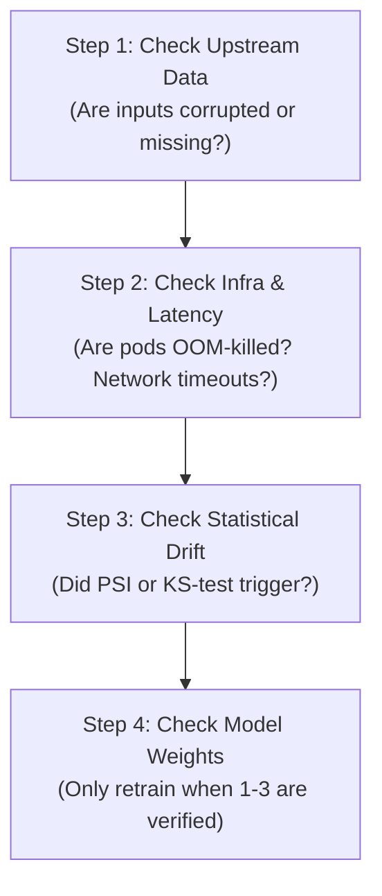

# MLOps On-Call Incident Response Runbook

> **Target Audience:** On-Call MLOps & Data Science Engineers  
> **Purpose:** Triage, mitigate, and resolve production ML incidents rapidly with zero panic.

---

## 1. Incident Severity Levels

| Level | Impact | Initial Response SLA | Actions Required |
|---|---|---|---|
| **SEV-1 (Critical)** | Silent predictions causing catastrophic business loss (e.g. 100% loans rejected, fraud model down). | **< 15 minutes** | Immediate rollback to Champion or heuristic fallback. Page team lead. |
| **SEV-2 (High)** | Statistical drift (PSI > 0.20) or P95 latency > 500ms on serving cluster. | **< 1 hour** | Divert traffic to secondary cluster; investigate feature distributions. |
| **SEV-3 (Moderate)** | Mild drift (0.10 <= PSI < 0.20), occasional 422 payload validation spikes. | **< 1 business day** | Review feature drift reports, schedule scheduled retraining run. |

---

## 2. Emergency Rollback Playbook (3 Options)

### Option A: Blue/Green Router Flip (Fastest: < 5 seconds)
If using the Blue/Green proxy router:
```bash
# Flip active traffic from candidate back to stable baseline
python release_strategies/blue_green_deploy.py
```

### Option B: Kubernetes / Nginx Traffic Re-weighting
Update canary weight to 0%:
```nginx
upstream ml_service_cluster {
    server 127.0.0.1:8001 weight=100; # Production Baseline
    server 127.0.0.1:8002 weight=0;   # Degraded Candidate (Disabled)
}
```
Reload proxy:
```bash
nginx -s reload
```

### Option C: Container Image Rollback
If a bad Docker container was deployed via Docker Compose or Kubernetes:
```bash
# Revert to previous Git SHA tag
docker compose stop inference-api
docker compose up -d --no-deps inference-api-previous
```

---

## 3. The 4-Step Incident Investigation Protocol



### Step 1: Upstream Data Checks
- Run data validation assertions on latest raw input batch:
  - Are there unexpected null values in feature columns?
  - Did column names change in the upstream data warehouse (Snowflake / BigQuery)?
  - Did the date format change (e.g., UTC to local timezone)?

### Step 2: Infrastructure Health Checks
- Inspect Prometheus metrics at `/metrics`:
  - `ml_prediction_requests_total{status=~"5.."}`
  - `ml_inference_duration_seconds` (p95 and p99 percentiles)
- Check container logs for unhandled exceptions using correlation IDs:
  ```bash
  docker logs mlops_inference_service | grep "ERROR" | tail -n 20
  ```

### Step 3: Statistical Drift Analysis
- Run `statistical_drift_tests.py` on the last 2,000 production inferences against the training baseline:
  ```bash
  python drift_detection/statistical_drift_tests.py
  ```
- Identify which specific feature drove the PSI spike.

### Step 4: Retrain and Validate
- Trigger the automated Airflow retraining DAG:
  ```bash
  airflow dags trigger ride_duration_retraining_pipeline
  ```
- Verify that validation MAE on the newly trained candidate meets the promotion threshold before re-enabling traffic.

---

## 4. Postmortem Report Template

Every SEV-1 and SEV-2 incident requires a blameless postmortem published within 48 hours:

```markdown
# Incident Postmortem: [YYYY-MM-DD] - [Brief Title]

**Date:** YYYY-MM-DD  
**Authors:** [Names]  
**Severity:** SEV-1 / SEV-2  
**Detection Time:** XX minutes  
**Time to Mitigate (TTM):** XX minutes  

### 1. Summary
A brief 2-3 sentence overview of what went wrong, impact on users, and how it was resolved.

### 2. Root Cause
Detailed technical explanation (e.g., Data Drift, Concept Drift, Upstream Schema change).

### 3. Timeline (UTC)
- **10:15:** Deployment of candidate model v1.2.
- **10:22:** P95 latency alert fires on Prometheus.
- **10:28:** On-call engineer acknowledges alert.
- **10:35:** Router flipped back to Blue environment. Service recovered.

### 4. Preventive Action Items
1. [Action 1] - Add schema contract test in CI/CD pipeline (Owner: Engineer A, Due: Date).
2. [Action 2] - Lower PSI alert threshold from 0.25 to 0.18 (Owner: Engineer B, Due: Date).
```
