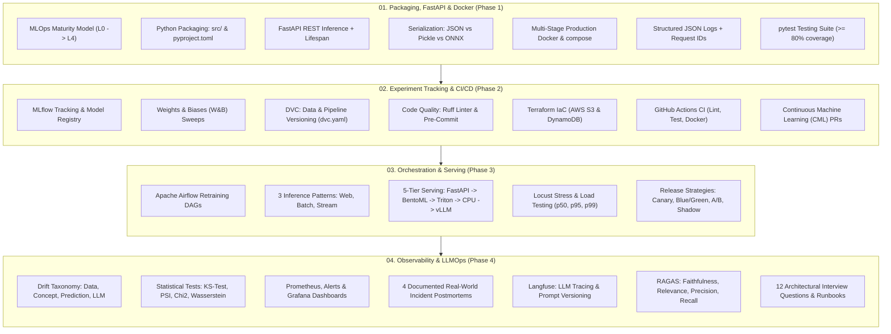

# 12 MLOps Engineering: Complete Production Curriculum & Reference

> **Welcome to the MLOps Engineering Master Reference.**  
> This curriculum is derived directly from the **MLOps Engineering Masterclass (5-Session Intensive)** by **Eng. Aya Nasser Salama** (*Founder of MLOps MENA Community, Senior MLOps Engineer*), aligned with the industry-standard *DataTalks.Club MLOps Zoomcamp*.
>
> Every module is **100% applied with runnable production code**, complete test suites, Docker configurations, infrastructure-as-code templates, and architectural runbooks designed as your permanent personal reference for data science and AI engineering.

---

## 🗺️ Master Curriculum Architecture Roadmap

---

## 📚 Curriculum Modules & Practical Reference

### [01. Packaging, FastAPI & Docker](./01_Packaging_FastAPI_Docker)
*Taking a model from a messy Jupyter notebook to an audited, containerized REST API.*
- **Core Topics:** MLOps Maturity Levels (0 to 4); why 87% of models die in notebooks; `src/` layout; `pyproject.toml`; FastAPI lifespan state pattern; serialization trade-offs (JSON vs. Pickle vs. ONNX); multi-stage Docker build reducing image size by 70%; structured JSON logging with correlation IDs (`X-Request-ID`); unit testing with `pytest`.
- **Applied Code & Artifacts:**
  - `src/app.py`: Production FastAPI service with middleware and lifespan management.
  - `src/model.py`: Clean OOP model wrappers (Scikit-Learn & ONNX Runtime).
  - `Dockerfile`: Multi-stage unprivileged non-root container.
  - `docker-compose.yml`: Local multi-service orchestration (API + Redis cache).
  - `scripts/train_and_export.py`: Scikit-learn and ONNX model export.
  - `scripts/benchmark_serialization.py`: Latency & size benchmarking.
  - `tests/`: Complete unit and boundary contract test suite.

---

### [02. Experiment Tracking & CI/CD](./02_Experiment_Tracking_and_CICD)
*Never lose an experiment again; automate testing, versioning, and cloud deployments.*
- **Core Topics:** Solving the `model_v2_final_REAL.pkl` chaos; MLflow Tracking & Model Registry (Staging $\to$ Production); Weights & Biases (W&B) collaborative sweeps; DVC (Data Version Control) content-addressable storage; reproducible pipelines (`dvc.yaml`); the Code + Data + Model lineage contract; Ruff linting; Git pre-commit hooks preventing large file commits; Terraform Infrastructure as Code (AWS S3 & DynamoDB); GitHub Actions CI/CD; Continuous ML (CML).
- **Applied Code & Artifacts:**
  - `dvc.yaml` & `params.yaml`: Reproducible 3-stage ML pipeline (`prepare` $\to$ `train` $\to$ `evaluate`).
  - `src/train_mlflow.py`: MLflow tracking, tags, signatures, and registry.
  - `src/train_wandb.py`: W&B cloud tracking and Bayesian sweep configuration.
  - `terraform/main.tf`: Declarative AWS S3 artifact store and DynamoDB lock table.
  - `.github/workflows/ci.yml`: Multi-stage GitHub Actions CI pipeline.
  - `.github/workflows/cml_train.yml`: Automated model retraining and PR commenting.
  - `tests/`: End-to-end integration and data contract tests.

---

### [03. Orchestration, Serving & Deployment](./03_Orchestration_Serving_Deployment)
*From task orchestration to high-throughput serving and zero-downtime releases.*
- **Core Topics:** Apache Airflow 5-component architecture; writing robust retraining DAGs (`catchup=False`, idempotent operators, sensor polling); the 3 core inference patterns (Web Service, Batch Scoring, Event Streaming); the 5-Tier serving stack (FastAPI $\to$ BentoML adaptive micro-batching $\to$ NVIDIA Triton GPU dynamic batching $\to$ ONNX/OpenVINO CPU acceleration $\to$ vLLM PagedAttention for LLMs); load testing with Locust; production rollout strategies (Blue/Green, Canary, A/B testing, Shadow mode dark launches).
- **Applied Code & Artifacts:**
  - `dags/ride_duration_retraining_dag.py`: Production Airflow weekly retraining DAG.
  - `patterns/01_web_service_bentoml/`: BentoML adaptive micro-batching service.
  - `patterns/02_batch_scoring/`: High-throughput Parquet offline batch scorer.
  - `patterns/03_streaming_kafka/`: Real-time streaming producer & consumer.
  - `serving_optimization/triton/`: NVIDIA Triton model repo & gRPC client.
  - `serving_optimization/vllm_llm_serving/`: vLLM LLM serving engine & token streaming client.
  - `load_testing/locustfile.py`: Locust concurrent user stress test.
  - `release_strategies/`: Nginx canary proxy config, Blue/Green deployer, A/B router, Shadow proxy.

---

### [04. Monitoring, Observability & LLMOps](./04_Monitoring_Observability_LLMOps)
*Detecting silent model failures, alerting on drift, and evaluating LLM/RAG systems.*
- **Core Topics:** Software fails loudly, models fail quietly; the 4 classic drift types (Data, Concept, Prediction, Upstream); the 8 LLM/RAG drift types; statistical drift formulas (Two-Sample KS-Test, Population Stability Index / PSI, Chi-Square, Wasserstein Earth Mover's Distance); Prometheus scraping and alerting rules; Evidently AI drift dashboards; 4 real-world incident postmortems (Banking, Computer Vision, RAG, Retail); Langfuse tracing, spans, and prompt management; RAGAS evaluation metrics (Faithfulness, Relevance, Precision, Recall); 12 MLOps architectural interview questions; on-call incident response runbooks.
- **Applied Code & Artifacts:**
  - `drift_detection/statistical_drift_tests.py`: Python implementations of KS-Test, PSI, $\chi^2$, and Wasserstein.
  - `drift_detection/evidently_monitoring_suite.py`: Automated HTML report and JSON metric generator.
  - `observability_stack/prometheus.yml` & `alerts.yml`: Production scraping and alert rules.
  - `observability_stack/instrumented_service.py`: FastAPI app with Prometheus metrics.
  - `real_world_incidents/incident_postmortems.md`: Detailed root-cause analyses of 4 real incidents.
  - `llm_observability_langfuse/langfuse_tracer.py`: Full Langfuse tracing & prompt versioning.
  - `rag_evaluation_ragas/ragas_evaluator.py`: Complete RAGAS metric evaluation pipeline.
  - `interview_prep_and_runbooks/`: 12 architectural Q&As and on-call response playbook.

---

## 🛠️ Technology Stack Matrix

| Category | Primary Technologies | Module |
|---|---|---|
| **API & Inference** | FastAPI, Uvicorn, Pydantic v2, Starlette | Module 01 |
| **Model Acceleration** | ONNX Runtime, Intel OpenVINO, NVIDIA Triton, vLLM | Modules 01, 03 |
| **Containerization** | Docker (Multi-stage), Docker Compose | Module 01 |
| **Experiment Tracking** | MLflow, Weights & Biases (W&B) | Module 02 |
| **Data & Pipeline Versioning** | DVC (Data Version Control), AWS S3 | Module 02 |
| **Code Quality** | Ruff (Rust linter/formatter), Pre-Commit hooks | Module 02 |
| **Infrastructure as Code** | Terraform (AWS S3, DynamoDB state locking) | Module 02 |
| **CI / CD / CML** | GitHub Actions, Iterative CML | Module 02 |
| **Orchestration** | Apache Airflow (DAGs, Operators, Sensors, XCom) | Module 03 |
| **Serving Frameworks** | BentoML (Adaptive Micro-Batching), Triton (Dynamic Batching) | Module 03 |
| **Load Testing** | Locust (p50, p95, p99 percentiles, RPS) | Module 03 |
| **Traffic Routing** | NGINX Canary Proxy, Blue/Green Router, Shadow Mode | Module 03 |
| **Statistical Drift Tests** | Population Stability Index (PSI), KS-Test, Chi-Square, Wasserstein | Module 04 |
| **Metrics & Observability** | Prometheus, Alertmanager, Grafana, Evidently AI | Module 04 |
| **LLM Tracing & Eval** | Langfuse (Tracing, Spans, Prompts), RAGAS (Faithfulness, Recall) | Module 04 |

---

## 📂 Source Course Slides
The original reference slide presentations by **Eng. Aya Nasser Salama** are preserved in the [`MlOps/`](./MlOps) directory:
- [`MlOps/01_MLOps.pdf`](./MlOps/01_MLOps.pdf): Session 1 — From Code to Container (47 slides)
- [`MlOps/02_MLOps.pdf`](./MlOps/02_MLOps.pdf): Session 2 — Shipping to Production (52 slides)
- [`MlOps/03_MLOps.pdf`](./MlOps/03_MLOps.pdf): Session 3 — Orchestration, Inference & Serving (81 slides)
- [`MlOps/04_MLOps.pdf`](./MlOps/04_MLOps.pdf): Session 4 — Monitoring, Observability & LLM Evaluation (73 slides)
