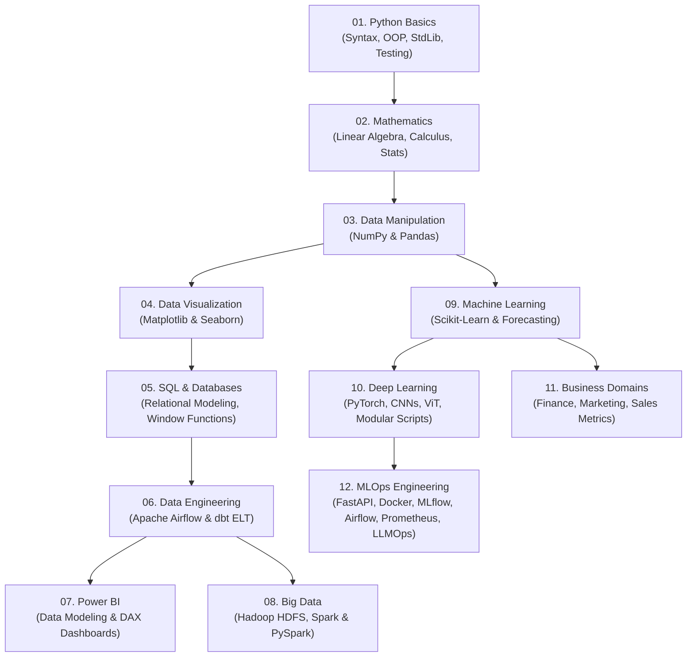

<div align="center">

# 📊 Data Science & Machine Learning Engineering Master Reference

### A structured, production-grade reference library spanning Python fundamentals, mathematics, data manipulation, visualization, SQL, data engineering, Power BI, big data, machine learning, PyTorch deep learning, commercial business domains, and end-to-end MLOps.

[](https://git.io/typing-svg)


</div>

---

## 📖 About This Repository

This repository is a **comprehensive personal Data Science & AI engineering knowledge base** designed to eliminate fragmented learning and repetitive web searches. Every module is self-contained with its own detailed `README.md`, verified Python scripts, interactive Jupyter notebooks, unit/integration test suites, and Dockerized infrastructure.

> 🎯 **Core Philosophy:** *Theory $\to$ Applied Implementation $\to$ Production Engineering $\to$ Commercial Business Impact.*

---

## 🗺️ Master Curriculum Roadmap

The recommended progression from zero programming knowledge to shipping autonomous machine learning pipelines in production:



---

## 📂 Modules & Syllabus Directory

| Module | Focus & Core Technologies | Key Contents |
|---|---|---|
| [**01_Python_Basics**](./01_Python_Basics) | Core Python 3, Data Types, Functions, OOP, Testing | 10 annotated scripts covering syntax, built-ins, closures, decorators, generators, OOP classes, dunders, standard library, `unittest`, and SQLite. |
| [**02_Mathematics**](./02_Mathematics) | Linear Algebra, Calculus, Probability, Advanced Statistics | 4 dedicated branches: Matrix operations, SVD/PCA, optimization derivatives, distributions, skewness, ANOVA, and hypothesis testing. |
| [**03_Data_Manipulation**](./03_Data_Manipulation) | Vectorized Computing (`NumPy`) & DataFrames (`Pandas`) | 17 reference scripts: array broadcasting, ufuncs, `.loc`/`.iloc` filtering, data cleaning, GroupBy, pivot/melt, relational merges, and time series. |
| [**04_Data_Visualization**](./04_Data_Visualization) | Exploratory Data Analysis with `Matplotlib` & `Seaborn` | Interactive plotting tutorials covering statistical distributions, box/violin plots, heatmaps, regression plots, and chart selection guidelines. |
| [**05_SQL**](./05_SQL) | Relational Databases, PostgreSQL, Query Optimization | 600-line master SQL tutorial script ([`sql_tutorial.sql`](./05_SQL/sql_tutorial.sql)) covering CTEs, window functions (`ROW_NUMBER`, `LEAD/LAG`), joins, indexing, and ACID. |
| [**06_Data_Engineering**](./06_Data_Engineering) | Modern ELT Pipelines, Orchestration & Modeling | Hands-on Dockerized **Apache Airflow** cluster and a complete **dbt** analytics engineering project with DuckDB, staging models, seeds, and marts. |
| [**07_PowerBI**](./07_PowerBI) | Business Intelligence, Interactive Visuals & DAX | Sample production `.pbix` report ([`Visuals.pbix`](./07_PowerBI/Visuals/Visuals.pbix)), star-schema modeling, and a comprehensive DAX measure formula reference. |
| [**08_Big_Data**](./08_Big_Data) | Distributed Computing, Hadoop Ecosystem & Apache Spark | The 5 Vs, HDFS fault tolerance, YARN resource negotiation, Spark in-memory DAG engine, lazy evaluation, RDDs vs. DataFrames, and PySpark workflows. |
| [**09_Machine_Learning**](./09_Machine_Learning) | Scikit-Learn Algorithms & Time Series Forecasting | Supervised, unsupervised, and ensemble methods (Random Forest, XGBoost) with applied notebooks, plus complete ARIMA, SARIMA, and Prophet forecasting. |
| [**10_Deep_Learning**](./10_Deep_Learning) | Modern Deep Learning with `PyTorch` | 9 hands-on notebooks following Daniel Bourke's curriculum: Tensors, custom datasets, CNNs (TinyVGG), modular scripts (`going_modular`), Transfer Learning, and Vision Transformers (ViT). |
| [**11_Business**](./11_Business) | Commercial Domain Knowledge & Unit Economics | Strategic guides covering **Finance** (EBITDA, Runway, Margins), **Marketing** (CAC, CLV, Churn, Funnels), **Sales** (Velocity, Pipelines), and a retail startup case study. |
| [**12_MLOps**](./12_MLOps) | Production Model Deployment, Monitoring & LLMOps | 4 production-grade modules based on the MLOps Masterclass: FastAPI REST APIs, multi-stage Docker, DVC & MLflow, Airflow DAGs, Triton/vLLM serving, Prometheus/Grafana, Langfuse, and RAGAS. |

---

## 🛠️ Global Tech Stack

```
Language:             Python 3.10+
Numerical & Data:     NumPy, Pandas, SciPy, Statsmodels, DuckDB
Plotting & BI:        Matplotlib, Seaborn, Power BI (DAX)
Relational & Big:     PostgreSQL, SQLite, Apache Spark (PySpark), Hadoop HDFS
Data Engineering:     Apache Airflow, dbt-core
Machine Learning:     Scikit-Learn, XGBoost, LightGBM, Prophet, SHAP
Deep Learning:        PyTorch, Torchvision, TensorBoard
MLOps & Serving:      FastAPI, Docker, Docker Compose, MLflow, DVC, BentoML, NVIDIA Triton, vLLM
Observability:        Prometheus, Grafana, Evidently AI, Langfuse, RAGAS
Code Quality & CI/CD: Ruff, Pre-Commit, Terraform, GitHub Actions, Pytest
```

---

## 💻 Getting Started

### 1. Clone the Repository
```bash
git clone https://github.com/ahmed123-cell/data-science-cheatsheets.git
cd data-science-cheatsheets
```

### 2. Set Up a Virtual Environment
```bash
python -m venv .venv
# Windows (PowerShell)
.\.venv\Scripts\Activate.ps1
# Linux / macOS
source .venv/bin/activate
```

### 3. Navigate to Any Specific Topic
Each module is completely self-contained. For example, to run the **MLOps Inference Service**:
```bash
cd 12_MLOps/01_Packaging_FastAPI_Docker
pip install -e .
python src/app.py
```
Or to run the **PyTorch Deep Learning Modular Trainer**:
```bash
cd 10_Deep_Learning
python going_modular/going_modular/train.py --num_epochs 5
```
Or to run the **Data Engineering dbt Pipeline**:
```bash
cd 06_Data_Engineering/dbt/dbt_project
dbt run
dbt test
```

---

## 📜 License & Acknowledgments

This reference repository is built for personal mastery and public knowledge sharing across the data science community.  
Special acknowledgments to:
* **Eng. Aya Nasser Salama** & *MLOps MENA Community* for the MLOps curriculum.
* **Daniel Bourke** (*learnpytorch.io*) for the PyTorch Deep Learning curriculum.
* **DataTalks.Club** for open-source engineering alignment.

---

## 💡 A Note on Learning

> You don't need to memorize everything in this repository.  
> The goal is to know **where to look** and **how to think** — not to store everything in your head.
>
> If you're ever stuck on a concept, a line of code, or an error:
> - Ask **[ChatGPT](https://chat.openai.com/)** or **[Claude](https://claude.ai/)** to explain it, debug it, or give you an example.
> - Use these AI tools as your always-available pair programmer and explainer.
>
> The best engineers aren't the ones who remember the most — they're the ones who know **how to find the answer**.

---

## ⭐ Support This Reference

If this repository saved you time, helped you learn, or became part of your workflow —  
**please give it a star on GitHub!** It helps others discover it and keeps the momentum going. 🚀

[](https://github.com/ahmed123-cell/data-science-cheatsheets)
